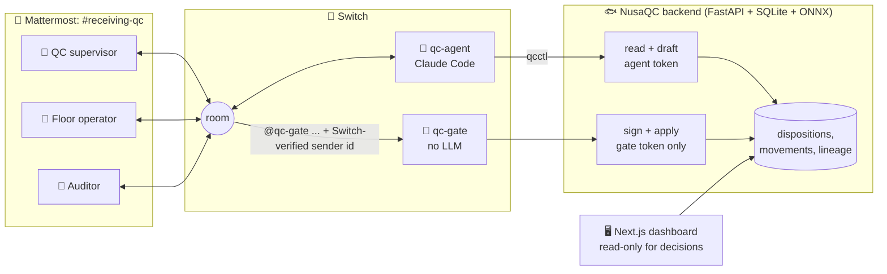
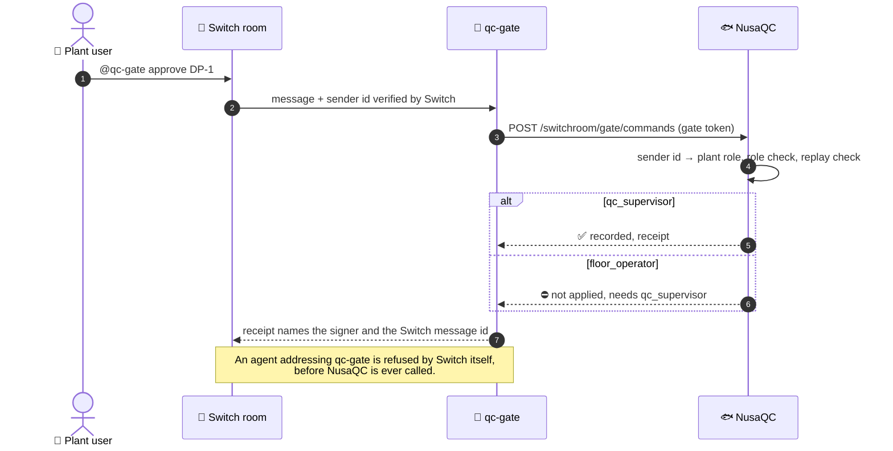
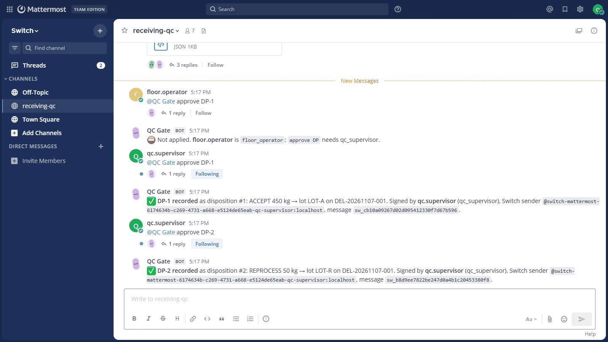
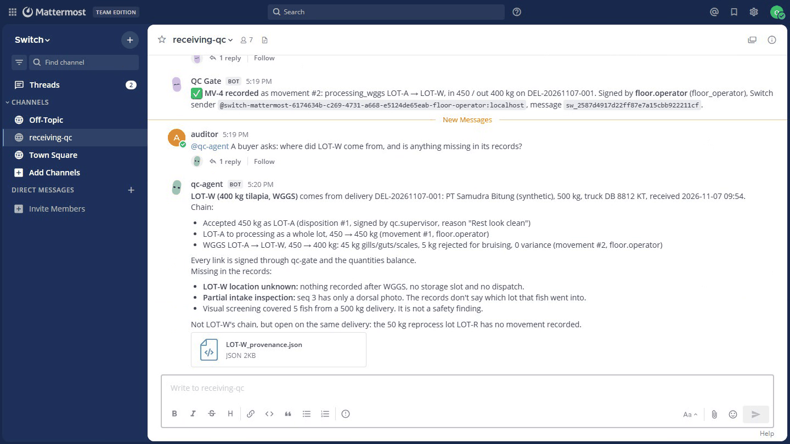
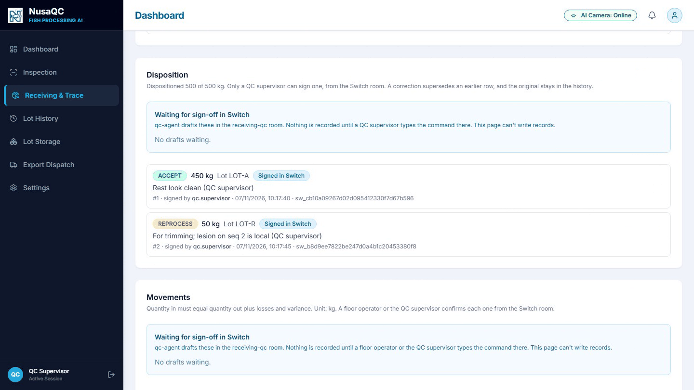
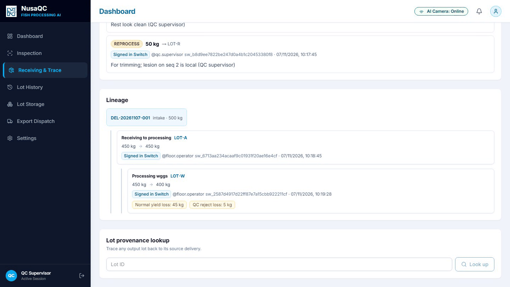

<div align="center">

# 🐟 NusaQC Receiving QC Room

### AI screens. People decide. Every decision is signed.

A Switch room where an AI agent screens incoming fish deliveries,<br/>and only a named, verified person can sign a quality decision.

[](https://youtu.be/pCowvaHkD3s) [](#-why-switch-the-removal-test) [](#-setup)

     

**[▶ Demo](#-watch-the-demo)** · **[🤔 Problem](#-the-problem)** · **[🔧 How it works](#-how-it-works)** · **[🧪 Removal test](#-why-switch-the-removal-test)** · **[🚀 Setup](#-setup)** · **[👥 Team](#-team)**

</div>

---

## ▶ Watch the demo

<div align="center">

[](https://youtu.be/pCowvaHkD3s)

**[youtu.be/pCowvaHkD3s](https://youtu.be/pCowvaHkD3s)** · 2 min 41 s

</div>

The problem, the idea, then a real run in the Switch room. The agent screens a delivery, a supervisor decides in plain words, a named person signs (and the floor operator is refused), the floor reports yields, and the auditor traces a lot back to the truck.

## ✨ At a glance

| | Step | Who | What happens |
|:-:|---|---|---|
| 🔍 | **Screen** | 🤖 qc-agent | Reads the inspection run and posts the flagged fish photos, with the model's boxes drawn on |
| 🧑‍⚖️ | **Decide** | 👤 QC supervisor | Makes the call in plain words; the agent turns it into drafts |
| ✍️ | **Sign** | 🔐 qc-gate + Switch | The record is written only when the sender Switch verified has the right role |
| 🧭 | **Trace** | 🔎 Anyone | Any lot walks back to the truck, with the signer on every step |

## 🤔 The problem

A fish processor takes **500 kg of tilapia** off a truck. A conveyor camera photographs each fish from above and below, and a vision model flags lesions, parasites and mucus. Someone then has to decide: accept, reject, reprocess or downgrade, how much, and why. Later, an auditor or a buyer asks which delivery a pallet came from, and who approved it.

In most plants that decision is made in a chat and typed into a form or a spreadsheet hours later, where anyone can type any name. The photos it depended on live on another screen, and the trace has silent gaps.

> ### 🕵️ *"Who decided this, looking at what?"*
> NusaQC already had the vision models and the lineage engine. What it lacked was a trustworthy answer to that question.

## 🔧 How it works



### 🎬 One delivery, start to finish

**1️⃣ The inspection run ends.** The operator tells the room. `qc-agent` pulls the run and posts a summary: 5 fish, 1 missing its ventral view, 1 flagged as a red lesion (0.86), 500 kg still undispositioned. It attaches the flagged fish's photo with the model's boxes drawn on.

**2️⃣ The supervisor decides in plain words.**

> 👤 **qc.supervisor:** Accept 450 kg as LOT-A, reprocess 50 for trimming, the lesion is local.

The agent turns that into drafts **DP-1** and **DP-2** and posts the exact command to sign each. The drafts are checked against the quantity rules right away, but **nothing is recorded yet.**

**3️⃣ A person signs.** Here is what the signature looks like on the wire:



<div align="center">

<br/><sub>⛔ The floor operator is refused. ✅ The supervisor's approvals are recorded, each receipt naming the Switch sender and message.</sub>
<br/><br/>
</div>

**4️⃣ The floor reports yields.**

> 👷 **floor.operator:** WGGS on LOT-A: in 450, out 400, guts and gills 45, rejects 5.

The agent checks the mass balance, drafts **MV-n**, and an operator confirms it with `@qc-gate confirm MV-n`.

**5️⃣ The auditor asks** *"where did LOT-W come from?"* The agent walks the lineage back to the truck and lists every gap out loud: a fish with only one view, a lot with no recorded movement.

<div align="center">

<br/><sub>🔎 The auditor's answer: the chain back to the truck, who signed each link, and what's missing.</sub>
<br/><br/>
</div>

### 🖥️ The same records on the dashboard

The dashboard can't write decisions. It shows pending drafts with their sign command, and badges every record **Signed in Switch**.

<table>
  <tr>
    <td width="50%"></td>
    <td width="50%"></td>
  </tr>
  <tr>
    <td align="center"><sub>Dispositions, each signed in Switch</sub></td>
    <td align="center"><sub>Lineage: delivery → LOT-A → LOT-W</sub></td>
  </tr>
</table>

## 🧪 Why Switch: the removal test

| ❌ Take Switch away and… | 💡 Because |
|---|---|
| **No disposition or movement can be recorded at all.** The web forms are gone, and the API's write routes return 403 to anything except the gate token. | Signing depends on the sender id Switch issues. A typed name is never accepted. |
| **Nobody can tell who approved a lot.** | Roles are bound to Switch participant ids in `switch_identities`, not to free text. |
| **An AI could approve its own drafts.** | Switch's addressing policy on `qc-gate` refuses every agent before NusaQC is even called. NusaQC then re-checks role and replay. |
| **The supervisor decides without seeing the evidence.** | The photos, the agent's analysis and the people from three jobs meet only in the room. |

Two layers of control, one in each system:

<table>
  <tr>
    <th width="50%">🔀 Layer 1: Switch</th>
    <th width="50%">🐟 Layer 2: NusaQC</th>
  </tr>
  <tr>
    <td>Decides <b>who may address the gate</b>. The addressing policy admits the room's plant users and no agent, qc-agent included.</td>
    <td>Decides <b>what each verified person may do</b>, and refuses replayed messages (<code>gate_commands.switch_message_id</code> is unique). The agent's token can read and draft; it can't write.</td>
  </tr>
</table>

## 📦 What's in the repo

| Path | What |
|---|---|
| 🤖 [`code/switch/agent/`](code/switch/agent/) | `qcctl.py`, qc-agent's only tool (stdlib CLI, prints JSON), and `CLAUDE.md`, its instructions and never-rules |
| 🔐 [`code/switch/gate/main.py`](code/switch/gate/main.py) | `qc-gate`: long-polls Switch agent events, relays `@qc-gate …` with the verified sender, posts the receipt. No LLM, no business logic |
| 🛠️ [`code/switch/setup/setup_switch.py`](code/switch/setup/setup_switch.py) | Idempotent setup: chat accounts, identity claims, room members, gate registration and policy, agent install |
| 🖼️ [`code/switch/demo/images/`](code/switch/demo/images/) | The real flagged image (`hf_00811`, open lesion) and clean tilapia images used by the seed |
| ⚖️ [`switchroom_service.py`](code/webdev/backend/app/services/switchroom_service.py) | Command grammar, role table, proposal validation, signed apply, receipts |
| 🔌 [`switchroom.py`](code/webdev/backend/app/api/v1/switchroom.py) | `/switchroom/proposals` (agent token), `/switchroom/gate/commands` (gate token), annotated-photo endpoint |
| 🌱 [`seed_demo.py`](code/webdev/backend/scripts/seed_demo.py) | Deterministic reset: 5 fish through the real two-view pipeline and the real models |
| ✅ [`test_switchroom.py`](code/webdev/backend/tests/test_switchroom.py) | Tokens, role refusal, replay, apply-time staleness, reject reasons, movement confirmation |
| 🖥️ [`deliveries/[id]/`](code/webdev/frontend/app/deliveries/) | Delivery workspace and trace page: pending drafts with their sign command, Signed in Switch badges |
| 📐 [`docs/designs/`](docs/designs/nusaqc_delivery_traceability.md) | Design doc for delivery traceability and the Switch write path |
| 📘 [`code/webdev/README.md`](code/webdev/README.md) | Backend and dashboard: architecture, full API, how to run |
| 🧠 [`code/models/`](code/models/) | How the two vision models were trained ([freshness](code/models/model_1/README.md), [defects](code/models/model_2/README.md)) and their measured limits |

## 🚀 Setup

**You'll need:**

- ✅ Switch Console 0.40.1 with its local server and Mattermost (Docker)
- ✅ Python 3.11+ with [uv](https://docs.astral.sh/uv/)
- ✅ Node 20+ with pnpm
- ✅ Claude Code, signed in for Console

**1. Backend** 🐍

```bash
cd code/webdev/backend
cp .env.example .env
# set QC_AGENT_TOKEN and QC_GATE_TOKEN to two different random values:
python -c "import secrets; print(secrets.token_urlsafe(32))"
uv sync
uv run uvicorn app.main:app --host 127.0.0.1 --port 8000
```

**2. Frontend** 🖥️

```bash
cd code/webdev/frontend
pnpm install
pnpm run dev        # http://localhost:3000/deliveries
```

**3. Switch Console** 🔀: connect the Mattermost messaging app, create a room named `receiving-qc`, and create a Claude Code agent named `qc-agent` in it. Paste this as the room instructions:

> Receiving QC for incoming fish deliveries. qc-agent summarizes inspection runs, posts flagged photos and drafts records. Only people sign, with `@qc-gate approve DP-n`, `@qc-gate reject DP-n <reason>`, `@qc-gate confirm MV-n` or `@qc-gate status DEL-…`.

**4. Wire it up** 🔌: creates the three demo accounts (`qc.supervisor`, `floor.operator`, `auditor`), claims their identities in Switch, registers `qc-gate` and sets its policy, and installs qc-agent's tool and instructions. It prints the bridge id.

```bash
python code/switch/setup/setup_switch.py --password '<demo password>'
```

It reads the Switch admin login from Console's `switch-core.env` (override with `--switch-env`) and writes the gate's key to `code/switch/gate/.env`, which is gitignored. See `code/switch/gate/.env.example`.

> [!TIP]
> Add `--fresh-room` to archive the existing `receiving-qc` room (reversible) and start an empty one. The script writes the new room id to `QC_ROOM_ID` in the gate's `.env`; restart the gate afterwards.

**5. Seed the demo** 🌱 and map the three Switch sender ids to plant roles:

```bash
cd code/webdev/backend
uv run python scripts/seed_demo.py --bridge <bridge id>
```

**6. Start the gate** 🔐

```bash
python code/switch/gate/main.py
```

**7. Go!** 🎉 Log in to Mattermost (`http://localhost:57079`) as `floor.operator` and post in `receiving-qc`:

```text
@qc-agent DEL-<today>-001 inspection done
```

**Tests:** `cd code/webdev/backend && uv run pytest` → 39 passing ✅

> [!NOTE]
> **Windows:** if agents never reply and Switch's log shows the Mattermost websocket hanging on `::1`, make IPv4 win for `localhost` (elevated): `netsh interface ipv6 set prefixpolicy ::ffff:0:0/96 60 4`. Undo it with `… 35 4`.

## 🏗️ Built during the hackathon vs. before it

| 📦 Before (imported 7 Nov, commits `9244f7f`–`60ebfca`) | ⚡ During the hackathon (7 Nov) |
|---|---|
| NusaQC web app: lot inspection, storage, dispatch | Delivery traceability: two-view conveyor capture, inspection status, dispositions, movements, mass balance, lineage and trace (`e7bd595`–`59e38f2`) |
| Edge runtime and camera drivers | The whole Switch layer: qc-agent and `qcctl`, qc-gate, setup script |
| Trained ONNX models (MobileNetV3 freshness, YOLOv8s defects) | Proposals, signed apply, identity-to-role mapping, replay protection, write routes locked to the gate |
| | Annotated-photo endpoint, demo seed, UI drafts panel and signature badges, Switch tests |

## ⚠️ Limits

> [!IMPORTANT]
> **Visual screening only.** The model flags what it sees. It never calls a fish safe or diseased, and the agent is told not to either.

- 👁️ Freshness grades come from eye and gill images. Species outside the model's scope come back `UNSUPPORTED` and count as unscreened.
- 💬 The gate uses Switch's custom-agent API with long polling. Because it is registered as a passive agent, Switch posts a short "I read room messages asynchronously" line before each receipt.
- 🧪 Demo data is synthetic (supplier, truck, quantities). The fish images are real.

**🔭 Next steps:** a background capture-timeout task, image checksum verification, separate review and floor rooms, and recall containment (holds and dispatch blocks).

## 🗺️ Repository map

```text
flip-the-switch/
├── code/
│   ├── switch/      # qc-agent tool and instructions, qc-gate, setup, demo images
│   ├── webdev/      # FastAPI backend and Next.js frontend
│   ├── edge/        # Raspberry Pi edge runtime and camera server
│   └── models/      # vision model training notes and annotation guide
└── docs/
    ├── designs/     # design doc for delivery traceability and the Switch write path
    └── images/      # README screenshots
```

## 👥 Team

<div align="center">

### Team 4 · IT Goes International

| Rayka Dharma Pranandita | Naufal Ardhana | Evan Christian Nainggolan | Rayhan Agnan Kusuma |
|:-:|:-:|:-:|:-:|

Built with 🔀 **Switch** and 🎙️ **Wispr Flow** · Demo voiceover and music by [ElevenLabs](https://elevenlabs.io)

</div>
