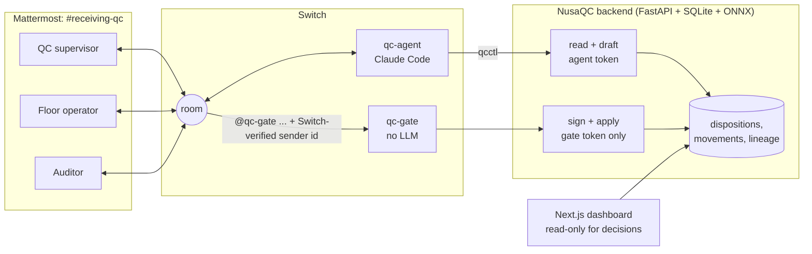

# NusaQC Receiving QC Room

**A Switch room where an AI agent screens incoming fish deliveries and named people sign every quality decision.**

Built for the *Flip the Switch* hackathon on top of NusaQC, an existing fish-QC vision system.

### ▶ [Watch the demo video (2:41)](https://youtu.be/pCowvaHkD3s)

[](https://youtu.be/pCowvaHkD3s)

The problem, the idea, then a real run in the Switch room: the agent screens a delivery, a supervisor decides in plain words, a named person signs (and the floor operator is refused), the floor reports yields, and the auditor traces a lot back to the truck.

## The problem

A fish processor takes 500 kg of tilapia off a truck. A conveyor camera photographs each fish from above and below, and a vision model flags lesions, parasites and mucus. Someone then has to decide: accept, reject, reprocess or downgrade, how much, and why. Later, an auditor or a buyer asks which delivery a pallet came from and who approved it.

In most plants that decision sits in a form or a spreadsheet where anyone can type any name. The photos the decision depended on live on another screen, and the trace has silent gaps. NusaQC already had the models and the lineage engine. What it lacked was a trustworthy answer to **"who decided this, looking at what?"**

## What happens in the room



1. **The inspection run ends.** The operator tells the room. `qc-agent` pulls the run and posts a summary: 5 fish, 1 missing its ventral view, 1 flagged as a red lesion (0.86), 500 kg still undispositioned. It attaches the flagged fish's photo with the model's boxes drawn on.
2. **The supervisor decides in plain words.** "Accept 450 kg as LOT-A, reprocess 50 for trimming, the lesion is local." The agent turns that into drafts **DP-1** and **DP-2** and posts the exact command to sign each. The drafts are validated against the quantity rules at draft time, but **nothing is recorded yet.**
3. **A person signs.** `@qc-gate approve DP-1`. `qc-gate` passes the command to NusaQC with the **sender id Switch put on the message**. NusaQC maps that id to a plant role, checks the role may do this, applies the record and replies with a receipt naming the signer and the Switch message id.
   - If the floor operator tries it, the answer is ⛔ *floor_operator cannot approve dispositions*.
   - If an agent tries to address the gate, **Switch itself refuses it**, because the gate's addressing policy admits plant users only.
4. **The floor reports yields.** "WGGS on LOT-A: in 450, out 400, guts and gills 45, rejects 5." The agent checks the mass balance, drafts **MV-n**, and an operator confirms it with `@qc-gate confirm MV-n`.
5. **The auditor asks** "where did LOT-W come from?" The agent walks the lineage back to the truck and lists every gap explicitly (a fish with one view, a lot with no recorded movement). The dashboard shows the same chain, with each record badged **Signed in Switch**.

### Why Switch is essential: the removal test

| Take Switch away and… | Because |
|---|---|
| **No disposition or movement can be recorded at all.** The web forms are gone, and the API's write routes return 403 to anything except the gate token. | Signing depends on the sender id Switch issues. A typed name is never accepted. |
| Nobody can tell who approved a lot. | Roles are bound to Switch participant ids in `switch_identities`, not to free text. |
| An AI could approve its own drafts. | Switch's addressing policy on `qc-gate` refuses every agent before NusaQC is even called. NusaQC then re-checks role and replay. |
| The supervisor decides without seeing the evidence. | The photos, the agent's analysis and the people from three jobs meet only in the room. |

There are two layers of control. **Switch** decides who may address the gate. **NusaQC** decides what each verified person may do, and refuses replayed messages (`gate_commands.switch_message_id` is unique). The agent's token can read and draft; it cannot write.

## What's in the repo

| Path | What |
|---|---|
| `code/switch/agent/` | `qcctl.py`, qc-agent's only tool (stdlib CLI, prints JSON), and `CLAUDE.md`, its instructions and never-rules |
| `code/switch/gate/main.py` | `qc-gate`: long-polls Switch agent events, relays `@qc-gate …` with the verified sender, posts the receipt. No LLM, no business logic |
| `code/switch/setup/setup_switch.py` | Idempotent setup: chat accounts, identity claims, room members, gate registration and policy, agent install |
| `code/switch/demo/images/` | The real flagged image (`hf_00811`, open lesion) and clean tilapia images used by the seed |
| `code/webdev/backend/app/services/switchroom_service.py` | Command grammar, role table, proposal validation, signed apply, receipts |
| `code/webdev/backend/app/api/v1/switchroom.py` | `/switchroom/proposals` (agent token), `/switchroom/gate/commands` (gate token), annotated-photo endpoint |
| `code/webdev/backend/scripts/seed_demo.py` | Deterministic reset: 5 fish through the real two-view pipeline and the real models |
| `code/webdev/backend/tests/test_switchroom.py` | Tokens, role refusal, replay, apply-time staleness, reject reasons, movement confirmation |
| `code/webdev/frontend/app/deliveries/[id]/` | Delivery workspace and trace page: pending drafts with their sign command, Signed in Switch badges |
| `docs/designs/nusaqc_delivery_traceability.md` | Design doc for the traceability feature and the Switch write path |
| `code/webdev/README.md` | Backend and dashboard: architecture, full API, how to run |
| `code/models/model_1/`, `code/models/model_2/` | How the two vision models were trained, and their measured limits |

## Setup

**Prerequisites:** Switch Console 0.40.1 with its local server and Mattermost (Docker), Python 3.11+ with [uv](https://docs.astral.sh/uv/), Node 20+ with pnpm, and Claude Code signed in for Console.

1. **Backend.**

   ```bash
   cd code/webdev/backend
   cp .env.example .env
   # set QC_AGENT_TOKEN and QC_GATE_TOKEN to two different random values:
   python -c "import secrets; print(secrets.token_urlsafe(32))"
   uv sync
   uv run uvicorn app.main:app --host 127.0.0.1 --port 8000
   ```

2. **Frontend.**

   ```bash
   cd code/webdev/frontend
   pnpm install
   pnpm run dev        # http://localhost:3000/deliveries
   ```

3. **Switch Console.** Connect the Mattermost messaging app, create a room named `receiving-qc`, and create a Claude Code agent named `qc-agent` in it. Paste this as the room instructions:

   > Receiving QC for incoming fish deliveries. qc-agent summarizes inspection runs, posts flagged photos and drafts records. Only people sign, with `@qc-gate approve DP-n`, `@qc-gate reject DP-n <reason>`, `@qc-gate confirm MV-n` or `@qc-gate status DEL-…`.

4. **Wire it up.** This creates the three demo accounts (`qc.supervisor`, `floor.operator`, `auditor`), claims their identities in Switch, registers `qc-gate` and sets its policy, and installs qc-agent's tool and instructions. It prints the bridge id.

   ```bash
   python code/switch/setup/setup_switch.py --password '<demo password>'
   ```

   It reads the Switch admin login from Console's `switch-core.env` (override with `--switch-env`) and writes the gate's key to `code/switch/gate/.env`, which is gitignored. See `code/switch/gate/.env.example`.

   Add `--fresh-room` to archive the existing `receiving-qc` room (reversible) and start an empty one. The script writes the new room id to `QC_ROOM_ID` in the gate's `.env`; restart the gate afterwards.

5. **Seed the demo** and map the three Switch sender ids to plant roles.

   ```bash
   cd code/webdev/backend
   uv run python scripts/seed_demo.py --bridge <bridge id>
   ```

6. **Start the gate.**

   ```bash
   python code/switch/gate/main.py
   ```

7. Log in to Mattermost (`http://localhost:57079`) as `floor.operator` and post in `receiving-qc`: `@qc-agent DEL-<today>-001 inspection done`.

**Tests:** `cd code/webdev/backend && uv run pytest` (39 tests).

**Windows note:** if agents never reply and Switch's log shows the Mattermost websocket hanging on `::1`, make IPv4 win for `localhost` (elevated): `netsh interface ipv6 set prefixpolicy ::ffff:0:0/96 60 4`. Undo it with `… 35 4`.

## Built during the hackathon vs. before it

| Before (imported 7 Nov, commits `9244f7f`–`60ebfca`) | During the hackathon (7 Nov) |
|---|---|
| NusaQC web app: lot inspection, storage, dispatch | Delivery traceability: two-view conveyor capture, inspection status, dispositions, movements, mass balance, lineage and trace (`e7bd595`–`59e38f2`) |
| Edge runtime and camera drivers | The whole Switch layer: qc-agent and `qcctl`, qc-gate, setup script |
| Trained ONNX models (MobileNetV3 freshness, YOLOv8s defects) | Proposals, signed apply, identity-to-role mapping, replay protection, write routes locked to the gate |
| | Annotated-photo endpoint, demo seed, UI drafts panel and signature badges, Switch tests |

## Limits

- **Visual screening only.** The model flags what it sees. It never calls a fish safe or diseased, and the agent is told not to either.
- **The detector mislabels the open ulcer** in `hf_00811` as a red lesion instead of an open wound. The demo keeps it on purpose: the model screens, the person decides.
- The defect model was trained with Indonesian class ids (`sisik_sisa`, `warna_abnormal`, `luka_robekan`, `lendir_berlebih`). They stay as stored ids; the chat, photos and dashboard show them in English as scale damage, red lesion, open wound and excess mucus.
- Freshness grades come from eye and gill images. Species outside the model's scope come back `UNSUPPORTED` and count as unscreened.
- The gate uses Switch's custom-agent API with long polling. Because it is registered as a passive agent, Switch posts a short "I read room messages asynchronously" line before each receipt.
- Demo data is synthetic (supplier, truck, quantities). The fish images are real.
- **Next steps:** background capture-timeout task, image checksum verification, separate review and floor rooms, recall containment (holds and dispatch blocks).

## Repository map

```text
flip-the-switch/
├── code/
│   ├── switch/      # qc-agent tool and instructions, qc-gate, setup, demo images
│   ├── webdev/      # FastAPI backend and Next.js frontend
│   ├── edge/        # Raspberry Pi edge runtime and camera server
│   └── models/      # vision model training notes and annotation guide
└── docs/
    └── designs/     # design doc for delivery traceability and the Switch write path
```

## Credits

Built by Praditya Haekal Islami A.H, Evan Christian N., Jonathan Zelig Sutopo, Rayka Dharma P. and Rayhan Agnan Kusuma, with Switch and Wispr Flow. Demo voiceover and music: [ElevenLabs](https://elevenlabs.io).
