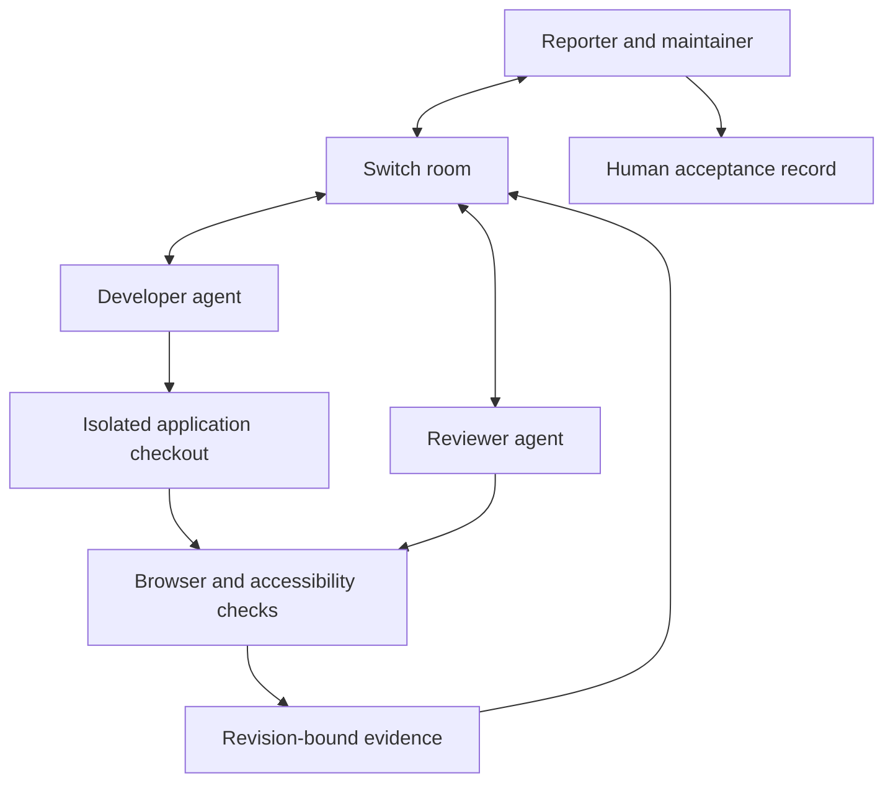

# AccessFix Room

> Resolve an accessibility barrier through agent-assisted repair and human acceptance.

**Status:** Candidate idea, still being explored. Proposed concept and implementation specification; not a verified integration.

**Target Switch version:** Switch Console **0.40.1**, which bundles switch-core **0.31.0** (from `artifacts.yaml` at tag `switch-console-v0.40.1`). See [Switch 0.40.1 compatibility check](#switch-0401-compatibility-check) for what was verified and what it changes.

**Purpose:** Standalone source of truth for AccessFix Room: problem, workflow, implementation scope, safeguards, and acceptance criteria.

## Competition and Switch principles

This project must satisfy the following product contract:

- At least one human and one agent get a real task done through Switch.
- Switch carries the discussion and handoffs that determine the outcome; it is not merely an optional notification channel.
- Demonstrate an actual artifact or state change, not an AI-generated recommendation alone.
- Existing infrastructure may be reused, but the Switch setup and collaborative workflow must comply with the event's build-period rules.
- Permissions and approval checks belong in application/tool code. Room instructions are not a security boundary.
- A reference attached to a Switch room does not grant access to the referenced system.

Use Switch Console and a supported chat application for the first connection. Prefer one room initially. Build custom transport only if Console cannot support a demonstrated requirement.

## Product definition

**Pitch:** A person reports an accessibility barrier; agents reproduce and repair it; a human verifies the improved experience.

AccessFix is not a general-purpose scanner. Its core workflow is:

**Reported barrier → clarification → reproduction → repair → independent review → human acceptance.**

### The problem

A user says, “I cannot complete this form using my keyboard.” A scanner reports technical violations. Neither automatically produces a correct repair.

The missing work is understanding the blocked task, reproducing it, finding the responsible component, making a safe change, and verifying the actual experience. This often gets fragmented across support conversations, developer tasks, and review comments.

### Users and roles

- **Reporter/designer:** describes the intended task and observed barrier.
- **Developer agent:** reproduces the issue and implements a correction.
- **Reviewer agent:** checks the changed behavior independently.
- **Human maintainer:** accepts the result and decides whether to merge.

A person may hold multiple roles in the demo. Two agents are useful because implementation and independent review are different responsibilities; agent count itself is not the product.

## Demonstration scenario

Use a controlled booking application with a faulty dialog:

- Opening it leaves focus behind the dialog.
- Tab reaches background controls.
- Closing it does not restore focus to the triggering button.

The reporter posts in the room:

> @accessfix I cannot complete a booking without using my mouse.

The agent asks which step blocks them. The reporter identifies opening the dialog and describes the background focus behavior.

The developer agent then:

1. Opens the application in a real browser.
2. Reproduces the reported keyboard sequence.
3. Captures the observed failure and identifies the component.
4. Proposes a narrow correction and implements it on an isolated branch.
5. Hands the revision and reproduction steps to the reviewer.

The reviewer checks initial focus, navigation, accessible naming, appropriate closing behavior, focus restoration, and completion of the booking flow. Any failure goes back as a concrete finding.

The human reporter tries the changed application and confirms whether the task is now usable. The maintainer accepts the exact reviewed revision. No automatic merge or deployment occurs.

## Deliverables

- Actual code patch or pull request.
- Before/after interaction evidence.
- Automated check results tied to the revision checked.
- Human verification instructions and acceptance record.
- Remaining limitations and unresolved findings.

**Success is a resolved user barrier, not an improved score alone.**

## Initial implementation scope

### Included

- One local web application.
- One interaction category: dialogs.
- A Switch room containing the reporter, agents, and maintainer.
- Browser-based reproduction with Playwright.
- Selected automated checks using axe-core.
- A revision-bound case record and human acceptance.

### Excluded

- Whole-site certification or legal-compliance claims.
- Arbitrary website scanning or untrusted repository execution.
- Autonomous merge, production deployment, or broad UI redesign.
- Claims about assistive technologies that were not actually exercised.
- Unbounded agent review loops.

## Proposed architecture and state

A small local case store should track:

- Case ID and reported user task.
- Reporter display name and source `message_id` and `room_id`, as Switch Console shows them to the agent. This is attribution, not authentication: the agent never sees the Switch participant id (see the compatibility check).
- Reproduction steps and observed result.
- Current code revision.
- Review findings and evidence paths.
- Human acceptance identity, timestamp, and revision.

States: `reported`, `clarifying`, `reproduced`, `fixing`, `reviewing`, `human_check`, `accepted`, and `blocked`.

If a fix changes after review, invalidate the relevant review and acceptance. After a bounded number of unsuccessful automated iterations, enter `blocked` and explain what requires human intervention.

Application/tool code must enforce write and merge permissions. Prompts may describe policy but cannot replace enforcement.

## Acceptance criteria

1. The reported keyboard interaction demonstrably fails before the fix.
2. A human clarification determines the reproduction or acceptance target.
3. The agent changes the actual responsible code.
4. The reviewer exercises the changed interaction in a browser.
5. The same reported task succeeds after the fix.
6. Evidence and acceptance identify the revision checked.
7. An unaccepted revision is not merged automatically.
8. The report distinguishes automated findings from human verification.
9. No claim of complete accessibility is inferred from selected checks.

## Switch fit and starting point

Switch connects the reporter's experience, implementation work, reviewer feedback, and maintainer acceptance in one workroom. Their contributions determine the task's outcome.

The repository's [red–blue workroom template](https://github.com/sandbox-quantum/switch/blob/main/examples/room-templates/red-blue-workroom.template.yaml) demonstrates a coder/reviewer loop with human confirmation. It is a starting pattern, not an implementation of accessibility checks or secure acceptance enforcement. At 0.40.1 it only creates the room from two agents that already exist, and its human gate is a sentence in the room instructions; see the compatibility check below.

## Switch 0.40.1 compatibility check

Checked on 2026-11-06 by reading the Switch repository at tag `switch-console-v0.40.1` (commit `6ab2ff4`). Source and doc reads only; nothing was run against a live server.

### Verified facts that affect AccessFix

| Topic | What 0.40.1 does | Source |
|---|---|---|
| Red–blue template | Room-only template. Takes two **existing** agents as `type: agent` params, creates one private room with them and the creator, posts a kickoff. Creates no agents. The human gate is the instruction "Only {$creator}'s explicit confirmation stops the loop", which is not enforced | `examples/room-templates/red-blue-workroom.template.yaml` |
| Providers | Templates and Console support `claude`, `codex`, `opencode` only | `docs/TEMPLATES.md` |
| What the agent sees per message | `[Switch] <name> (workspace <role>) addressed you in room <room_id> (message_id …, thread_id …)` plus the body inside nonce markers. No participant id | `console/packages/agent-providers/src/host/room-prompt.ts` |
| Files from people to agents | Downloaded into the agent's session directory: PNG, JPEG, WebP, PDF, text, Markdown, CSV, JSON, octet-stream; at most 8 per message, 10 MB each. **No video** | `.../host/attachments.ts`, `room-prompt.ts` |
| Files from agents to the room | `send_attachment` tool: any file type, one or several files per message, delivered to Mattermost as real uploads | `console/packages/switch-agent-runtime/src/hosted.ts` |
| Who may address an agent | `addressing: owner` (default), `owner-agents` (owner plus the owner's other agents), or `anyone` (every room member); finer allow-rules over rooms, groups, users and agents through the policy API | `docs/TEMPLATES.md`, `core/switch_core/addressing.py` |
| Agent-to-agent handoff | By @mention in the room. The task operations (`delegate_task` etc.) are "present but not ready for use" | `docs/official/internals/agent-protocol.md` |
| GitHub access for agents | `connections: [{service: github, access: read\|write, repos: [owner/name]}]` grants the deployer's GitHub App connection to an agent; connections must be enabled on the server. `repo:` alone grants nothing | `docs/TEMPLATES.md` |
| Room fields in templates | `instructions`, `roles` (`exclusive` option), `references` (GitHub, Google Drive, Confluence, Jira), `docs`, `aliases`; no `packages:` | `docs/TEMPLATES.md`, `docs/official/building/payments-room.md` |
| Agent directories | Each agent normally gets its own folder (`{$agents_dir}/{agent}`), so the developer and reviewer do not share a working tree | `docs/TEMPLATES.md` |
| Approval prompts | `auto_mode` (default on) still asks a person before risky actions; `auto_approve` bypasses all checks and is marked unsafe | `docs/TEMPLATES.md` |

### What this changes in the spec

1. **Use a custom template, not red–blue as-is.** Write one template with an `agents:` block that creates `accessfix-dev` and `accessfix-review` plus the room, so a judge can recreate everything in one step. Keep red–blue's instruction pattern and kickoff.
2. **Use different providers for independence.** For example, the developer on Claude Code and the reviewer on Codex. A different model reviewing makes "independent review" more than a label.
3. **Addressing.** The reporter is a different person from the deployer, so the developer agent needs `addressing: anyone` (or an allow-rule naming the reporter). The reviewer needs at least `owner-agents` so the developer can hand off; give it `anyone` if the reporter should be able to ask it questions.
4. **Handoffs by @mention only.** Don't build on Switch tasks at this version.
5. **Human acceptance is enforced by git, not by the room.** The agent cannot verify who typed "accepted", and the red–blue gate is only an instruction. So:
   - the developer pushes to a feature branch and opens a PR;
   - `main` is protected and only the maintainer's own GitHub account can merge;
   - the case record stores the reporter's confirmation as name plus `message_id` (attribution), and the maintainer's acceptance as the PR approval or merge (authentication).
6. **Sharing code between the two agents.** Separate directories mean the reviewer must fetch the developer's branch from a shared remote. Preferred: a GitHub repo with `connections` (developer `write`, reviewer `read`). Fallback if connections aren't enabled on the local server: a local bare repository both agents use as `origin`.
7. **Evidence goes both ways but asymmetrically.** Agents can post before/after screenshots, Playwright trace files and even screen recordings into the room with `send_attachment`. The reporter cannot send a video to the agents; ask for steps plus screenshots instead.
8. **Room setup.** Use `roles:` (`developer`, `reviewer`, both exclusive) so the room addresses jobs rather than agent names. Add a room `docs:` entry holding the dialog acceptance checklist, and a GitHub `references:` entry for the demo app repository.
9. **Pre-install Playwright browsers** on the agent machine. With `auto_mode` on, a first-time browser download may stop for approval mid-demo.

### Still open; needs a live 0.40.1 run

1. Are service connections (GitHub) enabled on the local server Console starts, or only on hosted servers?
2. Do `aliases:` and `roles:` in a template take effect at creation on 0.40.1?
3. Does the bridged reporter account need an identity claim before the `anyone` policy admits it? (`anyone` should admit all room members, but confirm with a second Mattermost account.)
4. Does Console 0.40.1 on Windows (early access) run Playwright-driven sessions and the local server reliably?

**Hackathon pitch:** “From ‘I cannot use this feature’ to a verified repair, without losing the user's experience between support and engineering.”

## Sources and evidence boundaries

- [Competition page](https://www.wemakedevs.org/hackathons/switch) and local `competition-ideation.md`: event context; organizer rules remain authoritative.
- [Switch red–blue template](https://github.com/sandbox-quantum/switch/blob/main/examples/room-templates/red-blue-workroom.template.yaml): inspected public coder/reviewer example on repository `main`; check installed-release compatibility.
- [Switch shared context](https://docs.switchagents.ai/switch-rooms/using/shared-context): room materials and their access limitations.
- Switch repository at tag `switch-console-v0.40.1` (commit `6ab2ff4`): `artifacts.yaml`, `docs/TEMPLATES.md`, `examples/room-templates/red-blue-workroom.template.yaml`, `docs/official/internals/agent-protocol.md`, `docs/official/building/payments-room.md`, `core/switch_core/addressing.py`, `console/packages/agent-providers/src/host/{room-prompt,attachments}.ts`, `console/packages/switch-agent-runtime/src/hosted.ts`.

The application workflow and acceptance criteria are proposed implementation requirements, not completed features or verified Switch built-ins.
