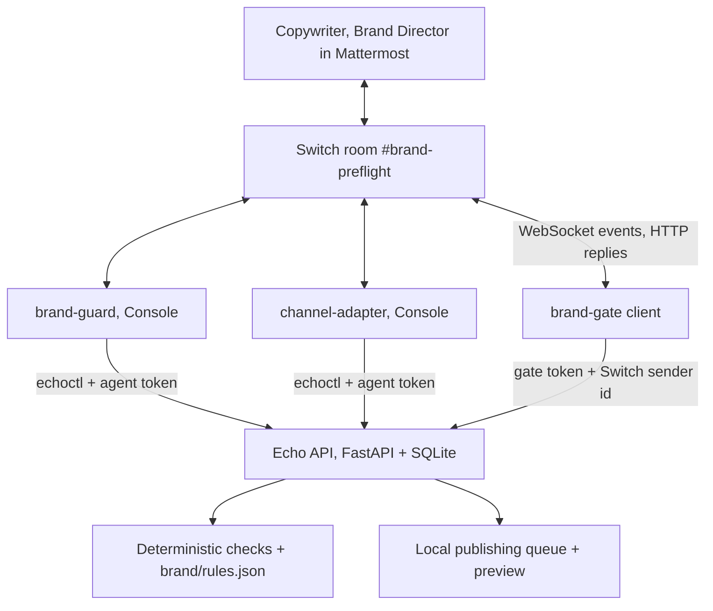

# BrandEcho Room

> A pre-flight gate for campaign assets: agents check copy and banners against the brand's rules and adapt the approved concept per channel; a Brand Director certifies the exact revision in the room; only certified assets enter the publishing queue.

**Status:** Candidate idea, still being explored. Not selected. Proposed concept and implementation specification; nothing below is built.

**Target Switch version:** Switch Console **0.40.1**, which bundles switch-core **0.31.0** (from `artifacts.yaml` at tag `switch-console-v0.40.1`). See [Switch 0.40.1 compatibility check](#switch-0401-compatibility-check) for what was verified and what it changes.

**Purpose:** Standalone source of truth for BrandEcho Room: problem, workflow, scope, safeguards and acceptance criteria.

**Track:** Best Business Workflow (also plausible for Personal or Creative Workflow).

## Competition and Switch principles

- At least one human and one agent get a real task done through Switch.
- Switch carries the discussion and handoffs that determine the outcome; it is not a notification channel.
- The result is a state change (assets accepted into the publishing queue), not an AI opinion.
- Permissions and approval checks belong in application/tool code. Room instructions are not a security boundary.
- **LLM agents propose; deterministic code decides.** An LLM's opinion of tone is shown to people; it never opens the gate.

## Product definition

**Pitch:** A copywriter drops a campaign concept and a banner into the room. Agents report exactly which brand rules it breaks, the team fixes it in the thread, an agent adapts the approved concept to each channel, and the Brand Director certifies the exact revision. The publishing queue refuses anything uncertified.

**Core workflow:**

**Submission → rule checks + tone review → director steer → revision → channel adaptation → certification → publishing queue.**

### The problem

When a brand runs campaigns across TikTok, Instagram, LinkedIn and display ads, assets drift: a freelancer uses a near-miss colour, a logo is cropped into the margin, a headline chases slang that contradicts the brand's positioning. Brand review is usually a person comparing a PNG to a PDF brand book, in comments spread across chat, email and design tools. Nobody can later show which version was approved, or whether the version that went live is the one the director saw.

**The problem is a reviewable, enforceable approval of the exact asset revision, not generating copy.**

### Users and roles

| Participant | Type | Contributes | App role |
|---|---|---|---|
| Copywriter | Person | Submits concept text and banners; applies fixes | `copywriter` |
| Brand Director | Person | Gives the creative steer; the only certifier | `brand_director` |
| `brand-guard` | AI agent (Claude Code via Console) | Runs `echoctl check`, reads the banner image, explains failures, gives an advisory tone review | `agent` (check, comment) |
| `channel-adapter` | AI agent (Codex or Claude Code via Console) | Writes per-channel copy variants from the approved concept and saves them as a revision | `agent` (draft only) |
| `brand-gate` | Deterministic Switch client (no LLM) | Receives `certify` commands with the Switch-issued sender id and calls the application | `gate` |

Each role uses a **separate Mattermost account**, so identity checks are real.

## Demonstration scenario

All brands, assets and people are **synthetic**. The fictional brand is "Kartu Teduh", a payment card whose positioning is calm, trustworthy money. Brand rules live in the repository as `brand/rules.json` (palette, logo file, minimum logo margin, banned terms, required tagline, per-channel length limits as configured) and in human-readable form as `brand/brand-bible.md`.

### Script

**Step 1: submission.**

> **Copywriter:** @brand-guard check concept: "Crazy fast crypto card. Swipe like a degen!" Banner attached.
> *(attachment: `card-launch-v1.png`)*

**Step 2: checks.** `brand-guard` runs `echoctl check CP-0001 --text … --image <downloaded path>` and posts:

> **CP-0001 r1: 3 rule failures** (rules v1.2, image sha256 5be0…)
> | Check | Result | Detail |
> |---|---|---|
> | Palette | ❌ | 38% of pixels are `#FF3366`, outside the palette (ΔE > 10 from every brand colour) |
> | Logo margin | ❌ | Logo found 8 px from the top edge; minimum 24 px |
> | Banned terms | ❌ | "degen" is on the banned list |
> | Tagline | ✅ | "Tenang soal uang" present |
> **Advisory (my reading, not a check):** "Crazy fast" works against the calm positioning in the brand bible.

**Step 3: director steer.**

> **Brand Director:** Tim kreatif, ganti latar ke Navy Slate `#0A192F`, geser logo ke dalam. Pesan fokus ke "Kebebasan finansial, tanpa cemas". Tetap premium.

**Step 4: revision.** The copywriter uploads `card-launch-v2.png` with the new text. `brand-guard` re-checks: **CP-0001 r2, all checks pass.**

**Step 5: channel adaptation.**

> **Copywriter:** @channel-adapter adapt CP-0001 r2 for TikTok, Instagram and LinkedIn.

`channel-adapter` writes the variants, runs `echoctl variants save CP-0001` (which re-runs the text checks on every variant), and posts **CP-0001 r3**: the r2 banner plus three variants, all passing.

**Step 6: certification, with two refusals.**

> **Copywriter:** @brand-gate certify CP-0001 r3
> **brand-gate:** ⛔ Not applied. Copywriter may not certify (requires brand_director; the submitter can never certify).
>
> **Brand Director:** @brand-gate certify CP-0001 r2
> **brand-gate:** ⛔ Not applied. CP-0001 r2 is superseded by r3.
>
> **Brand Director:** @brand-gate certify CP-0001 r3
> **brand-gate:** ✅ **Certified CP-0001 r3** (decision D-0001, Brand Director; manifest sha256 a41f…). 4 assets queued. Preview: http://localhost:8200/preview/CP-0001

**Step 7: state change shown.** The local publishing queue lists the four certified assets. Pushing the r1 banner straight to the queue API returns `409: not certified`. The gate uploads `campaign-manifest-CP-0001.json` and `ad-preview-gallery.html` into the room.

## Deliverables

- Certified assets in the local publishing queue (the state change).
- `campaign-manifest-CP-0001.json`: revision, asset sha256 hashes, per-channel copy, rule-check results, certifier and Switch message id.
- `ad-preview-gallery.html`: static mock feed previews for each channel.
- `decision_log.json` and the check history for every revision.

## Initial implementation scope

### Included

- One room, one brand, one campaign.
- Deterministic checks: palette share (Pillow; CIEDE2000 distance against the palette), logo margin (OpenCV template match with the brand logo), banned terms, required tagline, configured length limits.
- Advisory LLM tone review, labelled as advisory.
- Versioned concept revisions bound to content hashes.
- A gate with role, separation-of-duties and revision checks.
- A local publishing queue and preview gallery.

### Excluded

- Pushing to real ad networks (Meta, Google, TikTok).
- Generating or editing images. People supply banners.
- Brand "scores" that blend LLM judgement into the pass/fail decision.
- Claims of legal or regulatory compliance for ad content.

## Proposed architecture and state

**Case store tables:** `concepts`, `revisions` (`CP-n`, `rev`, manifest sha256, submitter user, status), `assets` (sha256, path, kind), `check_runs` (immutable, rules version), `decisions` (`switch_message_id` unique), `switch_identities`, `app_users`, `queue_items`.

**Revision states:** `draft` → `checks_failed` or `checks_passed` → `certified`; a new revision supersedes earlier ones.

**Gate checks (one SQLite transaction):**

1. `switch_message_id` already processed → repeat the receipt, change nothing.
2. `sender_role` not null and `sender` maps to an app user → else refuse.
3. Room id is `#brand-preflight` → else refuse.
4. User role is `brand_director`, and the user did not submit any asset in this revision → else refuse.
5. Revision is the latest and every check passed **on the current rules version** → else refuse.
6. Recompute asset hashes; they must equal the manifest → else refuse as changed.
7. Write the decision, enqueue the assets, commit, reply with a receipt from committed rows.

The agent token can run checks and save revisions but cannot certify or enqueue.

## Acceptance criteria

1. r1 fails palette, logo margin and banned-term checks with concrete values.
2. The director's steer leads to a revision that passes every check.
3. Variants are checked individually; one failing variant blocks certification.
4. The copywriter, a superseded revision, a changed asset file and a replayed message id are all refused.
5. Only certified assets appear in the publishing queue; a direct push of an uncertified asset returns 409.
6. The advisory tone review never changes a check result.
7. The manifest matches the queued files byte for byte.

## Switch fit

The room joins the creative work (copywriter), the brand judgement (director) and the agents' checks around the same assets, in one thread that the agents and both people see. Certification depends on a Switch-issued sender id reaching the gate. Without Switch, review goes back to comments scattered across tools, and nothing ties the director's approval to the exact files that were published.

**Honest weakness:** design tools already have review and approval features. BrandEcho's case rests on combining automated rule checks, channel adaptation and an enforceable sign-off in the chat where the team already works.

## Switch 0.40.1 compatibility check

Checked on 2026-11-06 by reading the Switch repository at tag `switch-console-v0.40.1` (commit `6ab2ff4`). Source and doc reads only; nothing was run against a live server.

### Verified facts that affect BrandEcho

| Topic | What 0.40.1 does | Source |
|---|---|---|
| Images from people to Console agents | PNG, JPEG, WebP (plus PDF, text, Markdown, CSV, JSON, octet-stream) downloaded into the agent's session directory; 10 MB each, at most 8 per message | `console/packages/agent-providers/src/host/attachments.ts`, `room-prompt.ts` |
| Files from agents to the room | Console agents: `send_attachment` tool. Custom clients: `POST /agents/{id}/rooms/{room_id}/media` (one or several files, caption, thread) | `console/packages/switch-agent-runtime/src/hosted.ts`; `core/switch_core/bridges/agent/api/handlers.py` |
| Live transport for custom clients | WebSocket at `/agents/{id}/connection/ws`; SSE legacy | `handlers.py` |
| What a custom client receives | `sender` participant id, `sender_name`, `message_id`, `body`, `thread_id`, `attachments` (pointers) | `docs/official/internals/agent-protocol.md` |
| What a Console agent sees | Display name and workspace role, no participant id | `.../host/room-prompt.ts` |
| Room documents | Template `docs:` entries are inline `name`, `description`, `instructions`, `content` (no file paths). Every agent that joins reads the room document. **An agent can only edit a document it created** | `core/switch_core/rooms_yaml.py` (`DocSpec`); `docs/official/using/shared-context.md` |
| Addressing | Rules over rooms, groups, users, agents; new agents start owner-only; non-admitted senders get one visible Switch refusal | `docs/official/internals/identity-and-access.md` |
| Gateway roles | `admin` is a global bypass | same |
| Agent-to-agent handoff | By @mention; tasks are "present but not ready for use" | `agent-protocol.md` |
| Local server ports | Random free ports chosen by Console on first run | `console/.../managed-switch-server/free-port.ts` |
| Providers | `claude`, `codex`, `opencode` only | `docs/TEMPLATES.md` |

### What this changes in the spec

1. **Pass/fail is deterministic.** Certification never depends on an LLM-generated score. Only the deterministic checks decide pass/fail; the LLM's tone review is advisory, and the director's certification is the human judgement.
2. **Sender identity is a Switch-issued participant id, not a signature.** The gate maps it to an app user and role in its own table.
3. **Image reading is Claude Code reading the downloaded file.** That works for describing a banner, not for measuring hex values or pixel margins, which is why palette and margin are computed in Python.
4. **Brand Director is not a Switch admin.** A Switch `admin` is a global bypass. Everyone is a `member`; the app maps participant ids to `brand_director` / `copywriter`.
5. **Brand rules have one source.** Machine-readable rules live in `brand/rules.json` in the repository and are what the checker uses. The room `docs:` entry carries the human-readable brand bible inline, created by the template (so owned by the deployer; agents can read but not edit it).
6. **Gate transport is WebSocket; configuration uses `SWITCH_API_ENDPOINT`** from Console, since local ports are random.
7. **Addressing:** `brand-guard` and `channel-adapter`: named users (copywriter, director) plus `owner-agents` for handoffs. `brand-gate`: users copywriter and director (the copywriter is admitted on purpose so the app's separation-of-duties refusal is shown), **no agents**.
8. **Tests run without Switch** (checks, gate logic, queue); the live room is the demo.

### Still open; needs a live 0.40.1 run

1. Can a client registered with `register-known` be listed in a template room?
2. Does a bridged Mattermost user keep a stable `sender` id?
3. Can per-agent addressing rules be set in the core 0.31.0 Gateway UI?
4. Do attachments uploaded by a person reach the Console agent intact (no recompression that would change hashes or colours)? The checker should hash the file the gate fetches from the media route, not a copy the agent re-saved.
5. Does Console 0.40.1 on Windows run the local server and Mattermost reliably?

## Sources

- [Competition page](https://www.wemakedevs.org/hackathons/switch) and local `competition-ideation.md`.
- Switch repository at tag `switch-console-v0.40.1` (commit `6ab2ff4`): `artifacts.yaml`; `docs/TEMPLATES.md`; `docs/official/internals/{agent-protocol,identity-and-access}.md`; `docs/official/using/shared-context.md`; `core/switch_core/bridges/agent/api/handlers.py`; `core/switch_core/rooms_yaml.py`; `console/packages/agent-providers/src/host/{room-prompt,attachments}.ts`; `console/packages/switch-agent-runtime/src/hosted.ts`; `console/apps/switch-console-desktop/src/main/core/managed-switch-server/free-port.ts`.

Named tables, endpoints, commands and tests are implementation requirements, not existing features.
