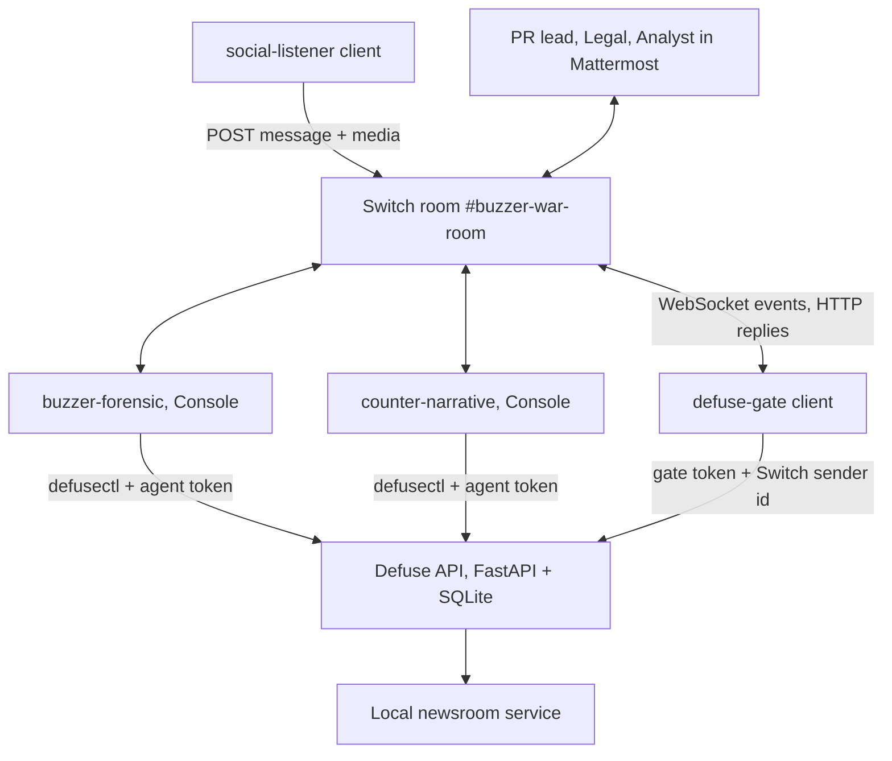

# BuzzerDefuse Room

> When a coordinated smear campaign hits a brand, forensic and drafting agents work with PR and Legal in one Switch room, and a public statement is released only after both PR and Legal approve the exact same revision.

**Status:** Candidate idea, still being explored. Not selected. Proposed concept and implementation specification; nothing below is built.

**Target Switch version:** Switch Console **0.40.1**, which bundles switch-core **0.31.0** (from `artifacts.yaml` at tag `switch-console-v0.40.1`). See [Switch 0.40.1 compatibility check](#switch-0401-compatibility-check) for what was verified and what it changes.

**Purpose:** Standalone source of truth for BuzzerDefuse Room: problem, workflow, scope, safeguards and acceptance criteria.

## Competition and Switch principles

- At least one human and one agent get a real task done through Switch.
- Switch carries the discussion and handoffs that determine the outcome; it is not a notification channel.
- The result is a state change (a statement published on the brand's newsroom), not an AI recommendation.
- Permissions and approval checks belong in application/tool code. Room instructions are not a security boundary.
- **LLM agents propose; deterministic code decides.** No LLM decides who approved, whether two approvals match, or whether something is published.

## Product definition

**Pitch:** A spike of coordinated posts falsely claims a product is contaminated. Agents separate coordinated activity from genuine customer complaints and draft an evidence-based response; PR and Legal shape it in the room; the statement is published only when both approve the same revision.

**Core workflow:**

**Alert → forensic clustering → human scope decision → draft → legal amendment → two-key approval → publication + case record.**

### The problem

Indonesian brands are regularly targeted by paid coordinated accounts (*buzzer*) that push a fabricated claim, often within hours. The response has to be fast and correct at the same time:

- **Fast**, because a false claim spreads before an official answer exists.
- **Correct**, because an emotional or over-broad corporate reply ("all batches are safe") creates legal exposure and can amplify the claim.
- **Careful**, because some of the angry posts are real customers with real complaints. Treating them as bots is both wrong and a reputational disaster.

Today PR, Legal and social media staff coordinate across WhatsApp groups, spreadsheets of screenshots and email drafts. Nobody can later show which version Legal actually cleared, or why a group of accounts was treated as coordinated.

**The problem is coordinated, evidence-backed crisis response with a verifiable sign-off, not detection.**

### Users and roles

| Participant | Type | Contributes | App role |
|---|---|---|---|
| PR crisis lead | Person | Decides scope and tone; first approval key | `pr_lead` |
| Legal officer | Person | Amends claims for liability; second approval key | `legal` |
| Social media analyst (optional) | Person | Confirms which posts are genuine customer complaints | `analyst` |
| `social-listener` | Deterministic Switch client (no LLM) | Posts the anomaly alert and the post payload into the room | — |
| `buzzer-forensic` | AI agent (Claude Code via Console) | Runs the clustering tool, explains coordination indicators, asks about borderline accounts | `agent` (read, analyse) |
| `counter-narrative` | AI agent (Claude Code or Codex via Console) | Drafts the statement, FAQ and response replies as versioned revisions | `agent` (draft only) |
| `defuse-gate` | Deterministic Switch client (no LLM) | Receives `release` / `cosign` commands with Switch-issued sender ids and calls the application | `gate` |

One person may play several roles in the recording, but each role uses a **separate Mattermost account**, so the identity checks are real.

## Demonstration scenario

All accounts, posts, brands and lab results are **synthetic**, seeded by `scripts/seed_demo.py`, and labelled as such.

**Seeded data:** a fictional bottled-water brand "Tirta Sejati". 60 posts in 10 minutes under `#TercemarBakteriTirta`:

| Group | Posts | Design | Expected classification |
|---|---|---|---|
| Cluster A | 42 | Accounts created < 48 h ago, near-identical text, posting every ~12 s | **Coordination indicators met** |
| Genuine complaints | 11 | Older accounts, varied text, some with purchase photos, two mentioning a real batch code | **Not coordinated: genuine complaints** |
| Borderline | 7 | Mixed signals (old accounts reposting the template) | **Needs human review** |

The genuine-complaint group is deliberate. The demo must show the system **not** labelling real customers as buzzers.

### Script

**Step 1: alert.** `social-listener` posts in `#buzzer-war-room`:

> ⚠️ Spike on `#TercemarBakteriTirta`: 60 posts / 10 min (baseline 3). Payload attached: `incident-20261106.json` (sha256 e4a7…). @buzzer-forensic

**Step 2: forensic clustering.** `buzzer-forensic` runs `defusectl cluster INC-0001` (deterministic Python) and posts:

> **INC-0001 forensic summary** (payload sha256 e4a7…, tool v0.1)
> | Group | Accounts | Account age < 48 h | Median gap | Text similarity (shingle Jaccard) |
> |---|---|---|---|---|
> | CL-A | 42 | 85% | 12.4 s | 0.89 |
> | Genuine | 11 | 0% | 6 min | 0.12 |
> | Borderline | 7 | 14% | 40 s | 0.61 |
> These are **coordination indicators**, not proof of who is behind the accounts. 11 posts look like genuine complaints, two citing batch `TS-2610-B`. **Scope decision needed:** respond to the claim publicly, and separately follow up the genuine complaints? I won't choose this.

**Step 3: human scope decision.**

> **PR lead:** Both. Public statement about the false contamination claim; customer care contacts the 11 genuine complainants. Borderline stays unclassified.

The agent records the scope with that message id.

**Step 4: draft.**

> **PR lead:** @counter-narrative draft the statement from the attached lab certificate. Factual, empathetic, no attacks on anyone.

`counter-narrative` reads `lab-cert-TS-2610.pdf` (attachment), runs `defusectl draft save INC-0001 --file statement.md`, and posts **DEBUNK-001 r1**: headline, three-paragraph statement, four-question FAQ, and the revision hash.

**Step 5: legal amendment.**

> **Legal:** Don't say "semua batch aman"; the certificate covers batch TS-2610-B only. Add the certificate number LAB-2026-0417. Do not name or accuse any account.

`counter-narrative` saves **DEBUNK-001 r2** and posts a diff.

**Step 6: two keys, plus two refusals.**

> **Analyst:** @defuse-gate release DEBUNK-001 r2
> **defuse-gate:** ⛔ Not applied. Analyst may not release statements (requires pr_lead).
>
> **PR lead:** @defuse-gate release DEBUNK-001 r2
> **defuse-gate:** 🔑 Key 1/2 from PR lead for DEBUNK-001 r2 (hash 9c1e…). Waiting for Legal.
>
> **PR lead:** @defuse-gate cosign DEBUNK-001 r2
> **defuse-gate:** ⛔ Not applied. The cosign must come from a different person with role legal.
>
> **Legal:** @defuse-gate cosign DEBUNK-001 r2
> **defuse-gate:** ✅ **Published DEBUNK-001 r2** (decision D-0001; keys: PR lead, Legal). Newsroom: http://localhost:8100/news/debunk-001

**Step 7: state change shown.** The local newsroom page now shows the statement. Trying to publish r1 directly through the newsroom API returns `409: not approved`. The gate posts the case record files with the media upload route.

## Deliverables

- A published statement on the local newsroom service (the state change).
- `exports/INC-0001/`: `forensic_report.md`, `clusters.csv`, `genuine_complaints.csv` (handed to customer care, not to any takedown), `statement_r2.md`, `decision_log.json` (both keys with Switch sender ids and message ids), `evidence_manifest.json` (sha256 of payload and lab certificate).
- An optional `platform_report_draft.json` listing only cluster CL-A, marked as a draft for a person to submit. Nothing is sent to any platform.

## Initial implementation scope

### Included

- One Switch room, one incident, synthetic data.
- Deterministic clustering (account age, posting interval, text shingle similarity) with fixed, documented thresholds.
- Versioned statement revisions with content hashes.
- Two-key gate with role, distinct-person and revision checks.
- A local newsroom service that publishes only gate-approved revisions.

### Excluded

- Live scraping of X, TikTok or Instagram. Payloads are files.
- Attribution claims ("this was paid for by competitor X").
- Automatic replies to accounts, reporting accounts to platforms or police, or legal action.
- Any classification that labels an individual as a buzzer in public output.

### Safeguards (product rules, enforced in code)

- Public output never names or quotes individual accounts.
- Genuine complaints are routed to customer care, never into a platform report.
- Borderline accounts stay unclassified unless a person classifies them.
- Thresholds are shown in every forensic summary; changing them creates a new analysis revision.

## Proposed architecture and state

**Case store tables:** `incidents`, `posts` (seeded), `analyses` (immutable, with thresholds and tool version), `scope_decisions` (with message id), `revisions` (`DEBUNK-n`, `rev`, `sha256`, status), `keys` (`revision`, `role`, `user_id`, `switch_sender_id`, `switch_message_id` unique), `decisions`, `switch_identities` (participant id → app user), `app_users`.

**Revision states:** `draft` → `awaiting_keys` → `key1` → `published`; any new revision moves earlier ones to `superseded` and voids their keys.

**Gate checks (one SQLite transaction):**

1. `switch_message_id` already processed → repeat the earlier receipt, change nothing.
2. `sender_role` not null and `sender` maps to an app user → else refuse.
3. Room id is the war room → else refuse.
4. `release` needs `pr_lead`; `cosign` needs `legal`.
5. The revision is the latest and its stored hash matches the file → else refuse as superseded.
6. For `cosign`: a `release` key exists for the same revision, from a **different** user.
7. Publish to the newsroom, write the decision, commit.
8. Reply with a receipt built from committed rows.

The agent token can save drafts and analyses but cannot write keys or publish. The newsroom accepts publish calls only with the gate's server credential.

## Acceptance criteria

1. Cluster CL-A meets the indicators; the 11 genuine posts are not classified as coordinated.
2. The scope decision is a recorded human message.
3. The Legal amendment changes the statement (r1 → r2) and voids nothing published.
4. An unauthorized role, the same person cosigning, a superseded revision and a replayed message id are all refused.
5. Before both keys, the newsroom has no statement; afterwards it shows exactly r2.
6. The newsroom refuses direct publication of an unapproved revision.
7. Exports match the database; no public artifact names an individual account.

## Switch fit

The war room is where three kinds of knowledge meet: the forensic picture (agent), tone and scope (PR) and liability (Legal). The two-key release depends on Switch-issued sender ids reaching the gate. Without Switch, the drafts and approvals go back to WhatsApp and email, and nothing can prove that Legal approved the version that went out.

## Switch 0.40.1 compatibility check

Checked on 2026-11-06 by reading the Switch repository at tag `switch-console-v0.40.1` (commit `6ab2ff4`). Source and doc reads only; nothing was run against a live server.

### Verified facts that affect BuzzerDefuse

| Topic | What 0.40.1 does | Source |
|---|---|---|
| Live transport for custom clients | **WebSocket** at `/agents/{id}/connection/ws`; SSE only for agent-protocol revision 7 and older; long poll fallback. The protocol doc at the tag still says SSE; the code is authoritative | `core/switch_core/bridges/agent/api/handlers.py` (`@router.websocket("/{agent_id}/connection/ws")`) |
| What a custom client receives | `message` payload: `addressed`, `sender` (participant id), `sender_name`, `sender_kind`, `on_behalf_of`, `message_id`, `body`, `timestamp`, `thread_id`, `attachments` (pointers, fetched from media routes) | `docs/official/internals/agent-protocol.md` (event catalog) |
| Participant ids | `@switch-<type>-<id>:<server>`; a person from a messaging app has their own `user` client. Treat as opaque | same |
| What a Console agent sees | `[Switch] <name> (workspace <role>) addressed you in room …` plus the body in nonce markers; no participant id. Agents have no role, so the role part is absent for agent senders | `console/packages/agent-providers/src/host/room-prompt.ts` |
| Posting without a connection | `POST /agents/{id}/message` `{room_id, content}` | `handlers.py` |
| Posting files | `POST /agents/{id}/rooms/{room_id}/media`, one or several files, optional caption and thread | `handlers.py` (`upload_media`) |
| Files from people to Console agents | PNG, JPEG, WebP, PDF, text, Markdown, CSV, JSON, octet-stream; 10 MB each | `.../host/attachments.ts` |
| Registering a custom client | `POST /agents/register-known` with a registration token; API key returned once; the token's user becomes the owner | `agent-protocol.md` (Writing a client) |
| Addressing | Rules over `rooms`, `room_groups`, `users`, `agents`; `owner`, `owner_agents`; new agents start owner-only; first rule flips to deny-by-default | `docs/official/internals/identity-and-access.md` |
| Refusal | A message from a sender the policy doesn't admit is demoted to chatter, and **Switch posts one visible reply** saying the agent can't act on it | same (Asymmetric refusal) |
| Identity claims | Many-to-many; an unclaimed account matches nobody | same |
| Gateway roles | Every Gateway user has a role; **`admin` is a global bypass** | same |
| Mattermost inbound filter | Posts with a non-empty `type`, from Switch's own bots, or from the Mattermost admin user are dropped; everything else is attributed to the posting user | `core/switch_core/bridges/collaboration/mattermost/adapter.py` (~line 2660) |
| Local server ports | Console picks **random free ports** for gateway, agent API, Mattermost and Postgres on first run and persists them | `console/.../managed-switch-server/free-port.ts` |
| Providers | `claude`, `codex`, `opencode` only | `docs/TEMPLATES.md` |
| Template rooms | `agents:` may name agents that already exist on the server (so the registered gate can be listed); `docs:` entries are inline `name`, `description`, `instructions`, `content` | `docs/TEMPLATES.md`; `core/switch_core/rooms_yaml.py` (`DocSpec`) |
| Tasks | "Present but not ready for use" | `agent-protocol.md` |

### What this changes in the spec

1. **Sign-off rests on Switch-issued ids, not signatures.** Switch provides a server-issued participant id, not a cryptographic signature. The gate's strength is: Switch-issued sender id → explicit app user mapping → role check → distinct-person check → revision hash. The receipt can include a SHA-256 of the case record, which is integrity of the export, not a signature by the approver.
2. **Gate transport is WebSocket**; SSE is the legacy path.
3. **The alert comes from a registered custom client (`social-listener`), not a Mattermost incoming webhook.** A webhook post is attributed to the user who created the webhook (and dropped entirely if that is the Mattermost admin user), so it would misattribute the alert. The listener posts with `POST /agents/{id}/message` and uploads the payload with the media route.
4. **Addressing:**
   - `buzzer-forensic`: `owner-agents` plus named users (PR lead, analyst), so the listener (same owner) can wake it.
   - `counter-narrative`: `owner-agents` plus PR lead and Legal.
   - `defuse-gate`: users PR lead, Legal, analyst; **no agents**, so no LLM can address it.
5. **Refusal wording comes from two layers.** For people outside the gate's policy, Switch itself posts the refusal; the gate never sees the message. The analyst is admitted by policy on purpose, so the demo shows the **application's** role refusal. Keep both in the README.
6. **Roles live in the app, not in Switch.** Making the PR lead a Switch `admin` would grant a global bypass. Use `member` accounts and an app table `switch_identities` that maps each participant id to an app role, seeded by an admin script. Refuse commands whose `sender_role` is null (unclaimed account). Because claims are many-to-many, the app mapping, not the claim, is the authority.
7. **Configuration:** local ports are random, so nothing is hard-coded. `.env.example` takes `SWITCH_API_ENDPOINT` (the agent API URL Console shows for the local server) and per-client agent ids and keys.
8. **Room setup:** one room. Room `docs:` (inline) holds the crisis procedure and the "never name accounts" rule; agents read it on joining.
9. **Two different providers is optional.** Claude for both agents lowers setup risk; Codex for `counter-narrative` makes the drafting independent of the analysis.

### Still open; needs a live 0.40.1 run

1. Can a client registered with `register-known` be listed in a template room, and does it receive events immediately?
2. Does a bridged Mattermost user keep a stable `sender` id across messages and restarts?
3. Can per-agent addressing rules (users list, empty agents list) be set in the core 0.31.0 Gateway UI, or only through the API?
4. Does the listener's @mention of `buzzer-forensic` in a `POST /message` body wake the Console agent under `owner-agents`?
5. Does Console 0.40.1 on Windows (early access) run the local server and Mattermost reliably?

## Sources

- [Competition page](https://www.wemakedevs.org/hackathons/switch) and local `competition-ideation.md`.
- Switch repository at tag `switch-console-v0.40.1` (commit `6ab2ff4`): `artifacts.yaml`; `docs/TEMPLATES.md`; `docs/official/internals/{agent-protocol,identity-and-access,life-of-a-message}.md`; `docs/official/using/shared-context.md`; `core/switch_core/bridges/agent/api/handlers.py`; `core/switch_core/bridges/collaboration/mattermost/adapter.py`; `core/switch_core/rooms_yaml.py`; `console/packages/agent-providers/src/host/{room-prompt,attachments}.ts`; `console/apps/switch-console-desktop/src/main/core/managed-switch-server/free-port.ts`.

Named tables, endpoints, commands and tests are implementation requirements, not existing features.
