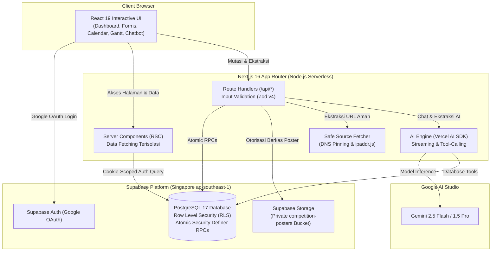
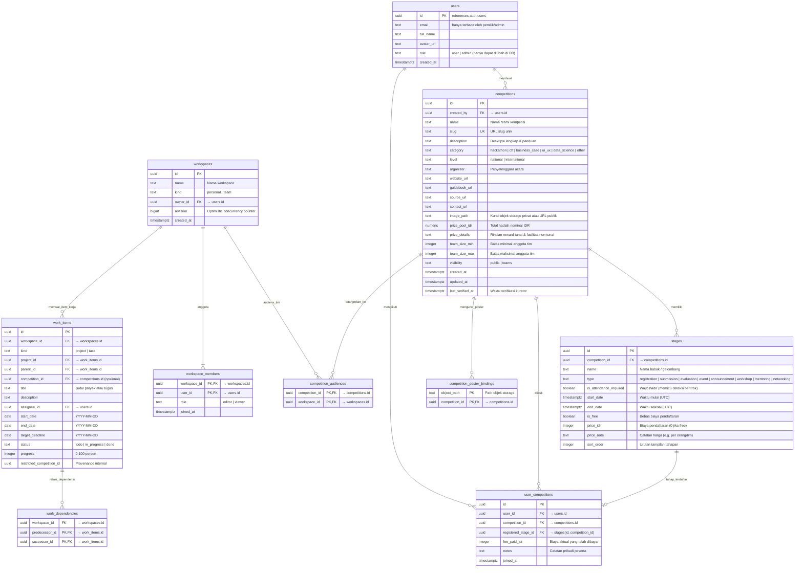

# Compe-In 🏆

> **Platform Terpadu Pencarian, Pelacakan Linimasa, Kolaborasi Proyek Tim, dan Asisten AI untuk Kompetisi Teknologi di Indonesia.**

Compe-In adalah platform web modern yang dirancang untuk membantu mahasiswa, pengembang perangkat lunak, desainer, dan penggiat teknologi di Indonesia dalam menemukan, melacak, dan menjuarai berbagai kompetisi teknologi (Hackathon, Capture The Flag / CTF, Business Case, UI/UX Design, Data Science, dan kompetisi inovasi lainnya).

---

## 📌 Daftar Isi
1. [Latar Belakang & Masalah](#-latar-belakang--masalah)
2. [Target Pengguna (User Personas)](#-target-pengguna-user-personas)
3. [Fitur Unggulan](#-fitur-unggulan)
4. [Arsitektur Sistem & Spesifikasi Teknis](#-arsitektur-sistem--spesifikasi-teknis)
5. [Model Data & Skema Database](#-model-data--skema-database)
6. [Panduan Menjalankan Proyek Lokal](#-panduan-menjalankan-proyek-lokal)
7. [Konfigurasi Variabel Lingkungan (`.env.local`)](#-konfigurasi-variabel-lingkungan-envlocal)
8. [Pengujian & Verifikasi Mutu (QA)](#-pengujian--verifikasi-mutu-qa)
9. [Prinsip Rekayasa Penting untuk Pengembang & AI Assistant](#-prinsip-rekayasa-penting-untuk-pengembang--ai-assistant)
10. [Struktur Direktori Repositori](#-struktur-direktori-repositori)
11. [Dokumentasi Terkait](#-dokumentasi-terkait)

---

## 💡 Latar Belakang & Masalah

Di ekosistem teknologi Indonesia saat ini, informasi seputar kompetisi mahasiswa dan profesional tersebar secara terfragmentasi di berbagai kanal (Instagram feeds, poster brosur PDF, channel Discord, LinkedIn, dan website institusi yang berbeda-beda). Hal ini menimbulkan kendala nyata:

1. **Jadwal Bertingkat yang Membingungkan**: Kompetisi modern memiliki gelombang pendaftaran (Early Bird, Regular, Late), babak penyisihan (Preliminary, Semifinal), hingga babak final tatap muka (*onsite*) yang sulit dipantau secara manual.
2. **Bentrok Waktu Kehadiran (*Attendance Conflicts*)**: Sering kali peserta mendaftar beberapa lomba sekaligus tanpa menyadari bahwa jadwal final atau evaluasi wajib kedua lomba bertabrakan pada hari dan jam yang sama.
3. **Penyusunan Jadwal & Kolaborasi Tim yang Terputus**: Setelah mendaftar, tim kesulitan membagi tugas persiapan, menetapkan target *deadline*, dan memetakan dependensi pekerjaan (Gantt timeline) terhadap tenggat waktu resmi panitia.
4. **Ekstraksi Informasi yang Lambat**: Menginput rincian lomba dari poster/caption berformat panjang memakan waktu dan rentan salah ketik tanggal.

**Compe-In** menyelesaikan masalah ini dengan menyediakan satu portal terpusat: katalog terkurasi, zona waktu terstandardisasi WIB, deteksi bentrok otomatis, asisten AI interaktif dengan akses data langsung, serta manajemen ruang kerja tim (*team workspaces*) berbasis Visual Gantt Timeline.

---

## 👥 Target Pengguna (User Personas)

1. **Mahasiswa & Tech Hunters**: Mahasiswa aktif yang ingin membangun portofolio prestasi, mencari rekan setim, dan memastikan tidak ada deadline pendaftaran beasiswa/lomba yang terlewat.
2. **Tim Pengembang & Desainer Hackathon**: Kelompok kolaborator yang membutuhkan ruang kerja terpadu untuk menyusun roadmap sprint proyek, membagi tugas teknis, dan mengunggah poster/panduan privat.
3. **Komunitas Kampus & Pembina Prestasi**: Organisasi mahasiswa (BEM/Himpunan) atau dosen pembina yang ingin mengkurasi serta membagikan kompetisi khusus bagi anggota internal tim mereka.
4. **Administrator & Kurator Katalog**: Pengelola sistem yang bertugas memverifikasi keabsahan informasi lomba, memperbarui tautan buku panduan, dan memastikan kebaruan data (*freshness audit*).

---

## 🚀 Fitur Unggulan

### 1. 🔍 Katalog Cerdas & Multi-Filter Real-time
- **Kategori Spesifik**: Hackathon, CTF, Business Case, UI/UX Design, Data Science, dan Other.
- **Jenjang & Biaya**: Filter Nasional vs Internasional, Gratis vs Berbayar (dengan deteksi biaya terendah dari *registration stages*).
- **Status Otomatis**: Transisi status dinamis (`upcoming`, `open`, `closing_soon`, `ongoing`, `unscheduled`, `ended`) dihitung langsung dari tanggal tahapan terkini.
- **Informasi Hadiah**: Menampilkan total hadiah tunai (IDR) atau label semantik penghargaan non-tunai (tiket akomodasi, piala resmi, voucher ujian sertifikasi internasional).

### 2. 📅 Kalender Interaktif Terpadu (WIB / UTC+7)
- **Tampilan Fleksibel**: Pilihan mode Bulanan (*Month*), Mingguan (*Week*), dan Agenda.
- **Bulan dengan Bar Lintas Tanggal**: Sel bertinggi tetap menyediakan dua jalur tahapan. Bar multi-hari tersambung sepanjang minggu tanpa pindah jalur; tahapan di jalur berikutnya dihitung oleh tombol `+N lainnya`, mulai dari tahapan ketiga yang bertumpuk. Jalur kosong pada tanggal yang lebih sepi tidak mempromosikan bar tersembunyi.
- **Kartu Tanggal Mengambang**: Tombol overflow membuka semua tahapan tanggal tersebut, termasuk dua bar yang terlihat, dalam kartu non-modal yang dibatasi viewport dan dapat di-scroll. Pita menunjukkan arah kelanjutan relatif terhadap tanggal terpilih; jadwal satu hari memakai titik warna. Mendukung keyboard, penutupan di luar kartu, dan pemulihan fokus setelah detail ditutup.
- **Hitungan per Tahapan**: Tanggal dan kelanjutan mengikuti WIB; tahapan berbeda dari kompetisi sama tetap dihitung terpisah. Filter diterapkan sebelum penempatan dan hitungan. Minggu tetap memakai bar lintas tanggal, Agenda tetap daftar lengkap dan menjadi tampilan awal mobile.
- **8 Kategori Tahapan**: Kode warna visual yang jelas untuk `registration`, `submission`, `evaluation`, `event`, `announcement`, `workshop`, `mentoring`, dan `networking`.
- **Detail Event Modal**: Inspeksi cepat nama kompetisi, batas waktu, status wajib hadir, dan tautan langsung ke halaman detail.

### 3. ⚠️ Deteksi Bentrok Jadwal Otomatis (*Attendance Conflict Scanner*)
- Sistem secara otomatis memindai seluruh kompetisi yang diikuti peserta (`/my`).
- Mengidentifikasi tumpang tindih waktu pada tahapan yang mensyaratkan kehadiran fisik/online wajib (`is_attendance_required = true`).
- Menghitung rentang waktu bentrok (*overlap interval*) dan memberikan peringatan visual sebelum peserta mendaftar ke lomba lain.

### 4. 🪄 Smart Import (AI Extractor Berbasis Gemini AI)
- Ekstraksi instan dari URL website resmi lomba atau dokumen/caption teks media sosial.
- Menghasilkan struktur data valid: nama, penyelenggara, kategori, jenjang, rincian hadiah, ukuran tim, serta tahapan lengkap beserta tanggal mulai & selesai.
- **Proteksi SSRF Berlapis**: Menggunakan validasi IP publik (`ipaddr.js`), pemblokiran jaringan privat/lokal (RFC 1918, link-local, loopback, cloud metadata), *DNS pinning*, dan limitasi byte stream 1 MiB.

### 5. 🤖 Asisten AI Terintegrasi (Grounding Database Langsung)
- Chatbot cerdas bertenaga Google Gemini yang dapat diajak berdiskusi di pojok kanan bawah aplikasi.
- Dilengkapi alat bantu (*tool-calling*) langsung ke database dengan otorisasi berbasis sesi pengguna:
  - `searchCompetitions`: Pencarian lomba berdasarkan minat, kategori, atau jenjang.
  - `getCompetitionDetail`: Membaca detail lengkap dan timeline kompetisi tertentu.
  - `getUserJoinedCompetitions`: Mengecek status lomba yang telah diikuti pengguna.
  - `getUpcomingDeadlines`: Mengingatkan batas waktu terdekat yang perlu diselesaikan.

### 6. 🗂️ Workspaces & Manajemen Proyek Tim (Visual Gantt Timeline)
- **Ruang Kerja Fleksibel**: Mendukung Workspace Personal (pribadi) dan Workspace Tim (kolaborasi banyak anggota).
- **Manajemen Hirarki**: Pengorganisasian berjenjang dari Proyek (*Project Root*), Tugas (*Tasks*), hingga Subtugas.
- **Visual Gantt Timeline**:
  - Pelacakan progres visual (0–100%) dengan status `todo`, `in_progress`, dan `done`.
  - Penandaan batas akhir (*target deadline*) dan tanggal pelaksanaan.
  - Overlay tahapan resmi lomba (*official stages overlay*) langsung di atas jadwal pengerjaan proyek tim.
- **Dependensi Tugas (Predecessor & Successor)**:
  - Menghubungkan tugas prasyarat dengan tugas lanjutan.
  - Penjadwalan otomatis yang mencegah tugas penerus selesai mendahului tugas pendahulu.
  - Deteksi tubrukan jadwal (*collision preview*) dan transaksi penyimpanan atomik (`atomic_schedule_commit`).
- **Administrasi Tim & Undangan**:
  - Pembuatan tautan undangan berbasis token hash berwaktu kedaluwarsa (`/invite`).
  - Pembagian hak akses: Pemilik (*Owner*), Editor, dan Pengamat (*Viewer*).
  - Pemindahan proyek antar-workspace dengan pelacakan *provenance* data.

### 7. 👥 Kompetisi Khusus Tim & Poster Privat Aman
- Opsi visibilitas: `public` (dapat diakses seluruh pengguna terdaftar) atau `teams` (hanya dapat dilihat oleh anggota workspace tim yang dipilih).
- Hak edit kolaboratif: Semua anggota tim audiens dapat memperbarui konten deskripsi dan tahapan, sedangkan hak ganti audiens atau hapus tetap eksklusif milik pembuat (*creator*) atau admin.
- **Penyimpanan Poster Privat**: Berkas poster diunggah ke *private bucket* Supabase Storage (`competition-posters`). Aliran berkas dilayani melalui endpoint `/api/posters/[...path]` dengan verifikasi RLS database dan *header* `Cache-Control: private, no-store`. Pencabutan keanggotaan tim secara otomatis memutus akses terhadap poster dan proyek privat.

### 8. 🛡️ Panel Admin & Kurasi Data
- Dashboard moderasi khusus bagi akun dengan role `admin` di database.
- Indikator kesegaran data (*staleness check*): Lomba yang belum diverifikasi selama >30 hari diberi tanda peringatan agar ditinjau ulang.
- Verifikasi kurasi satu klik untuk memperbarui cap waktu `last_verified_at`.

---

## 🏗️ Arsitektur Sistem & Spesifikasi Teknis

Compe-In dibangun menggunakan arsitektur modern berkinerja tinggi yang mengutamakan keamanan dan integritas transaksi:



### Ringkasan Lapisan Teknologi (Tech Stack)

| Lapisan | Teknologi | Versi | Justifikasi & Peran |
|---|---|---|---|
| **Frontend Core** | Next.js App Router | 16.3.7 | Server Components untuk kecepatan katalog, layout caching, asynchronous cookies & params. |
| **UI Library** | React | 19.2.8 | Primitif reaktif modern, transisi halus, `<dialog>` native untuk aksesibilitas modal. |
| **Styling** | Tailwind CSS | 4.x | Utilitas CSS modern performan tinggi, dukungan CSS variables native (`--gantt-label-w`). |
| **Database** | PostgreSQL (Supabase) | 17.x | Transaksi atomik PL/pgSQL, Row Level Security (RLS), constraint integritas composite FK. |
| **Autentikasi** | Supabase SSR Auth | 0.12.7 | Google OAuth 2.0 terpadu, validasi return URL aman (`safeReturnPath`) tanpa open-redirect. |
| **Penyimpanan Berkas**| Supabase Storage | 2.x | Bucket privat dengan Storage RLS terikat tabel kepemilikan poster dan audiens tim. |
| **Kecerdasan Buatan** | Vercel AI SDK + Google Gemini | 7.x | Provider terpadu di `src/lib/ai/provider.ts` untuk streaming multi-turn dan ekstraksi JSON. |
| **Validasi Skema** | Zod | 4.x (`zod/v4`) | Validasi data input ketat di API dan form klien dengan error reporting multibahasa. |
| **Pengujian** | Vitest | 3.2.7 | Unit testing cepat dan isolasi skenario integrasi end-to-end. |

---

## 🗄️ Model Data & Skema Database

Database PostgreSQL Compe-In menggunakan 11 tabel relasional dengan penegakan integritas referensial dan RLS:



---

## 💻 Panduan Menjalankan Proyek Lokal

### Prasyarat
- **Node.js**: Versi `20.x` atau `22.x` (sangat disarankan `v22.x LTS`).
- **NPM**: Versi `10+`.
- **Akun Supabase**: Proyek Supabase aktif (Free Tier cukup).
- **Akun Google AI Studio**: Kunci API Gemini untuk fitur ekstraksi dan chatbot.

### Langkah-langkah Instalasi

```bash
# 1. Kloning repositori
git clone https://github.com/Rkaaaa404/compe-in.git
cd compe-in

# 2. Pasang dependensi secara bersih
npm ci

# 3. Buat file konfigurasi lingkungan lokal
cp .env.example .env.local

# 4. Buka .env.local dan isi kredensial Supabase serta Google Gemini Anda
# (Lihat tabel variabel lingkungan di bawah)

# 5. Jalankan server pengembangan lokal
npm run dev

# 6. Buka peramban di http://localhost:3000
```

---

## 🔐 Konfigurasi Variabel Lingkungan (`.env.local`)

Salin dari `.env.example` ke `.env.local`:

| Nama Variabel | Wajib | Keterangan & Lokasi Mendapatkan |
|---|---|---|
| `NEXT_PUBLIC_SUPABASE_URL` | **Ya** | URL endpoint proyek Supabase (`https://<project-ref>.supabase.co`). Didapatkan di Supabase Dashboard → Settings → API. |
| `NEXT_PUBLIC_SUPABASE_ANON_KEY` | **Ya** | Kunci anon/publik Supabase. Didapatkan di Supabase Dashboard → Settings → API. |
| `GOOGLE_GENERATIVE_AI_API_KEY` | **Ya** | Kunci API Google AI Studio untuk Gemini. Dapatkan di [aistudio.google.com](https://aistudio.google.com/). |
| `GEMINI_API_KEY` | Opsional | Kunci cadangan jika nama variabel standar tidak tersedia. |

> ⚠️ **PENTING — Keamanan Variabel**:
> - **Jangan gunakan `ADMIN_EMAIL`**: Hak administrator tidak ditentukan oleh env var, melainkan kolom role di database (`public.users.role = 'admin'`).
> - **Jangan pernah membocorkan `service_role` key**: Kunci service role Supabase **dilarang** dimasukkan ke dalam `.env.local` atau Vercel Environment Variables. Aplikasi bekerja secara ketat menggunakan session-scoped client dengan RLS database.

### Bootstrap Akun Admin Pertama Kali
Setelah Anda berhasil login pertama kali menggunakan Google OAuth:
1. Masuk ke **Supabase Dashboard** → **SQL Editor**.
2. Jalankan perintah SQL berikut:
   ```sql
   UPDATE public.users SET role = 'admin' WHERE email = 'email-google-anda@gmail.com';
   ```
3. Akun Anda kini memiliki akses ke halaman kurasi `/admin`.

---

## 🧪 Pengujian & Verifikasi Mutu (QA)

Repositori ini memelihara pengujian ketat untuk menjamin stabilitas fungsional:

```bash
# Menjalankan seluruh Unit Tests (Vitest)
npm test

# Menjalankan pemeriksaan tipe TypeScript tanpa kompilasi berkas
npx tsc --noEmit

# Menjalankan build produksi Next.js (mengecek bundling & rendering)
npm run build

# Menjalankan linter kode
npm run lint

# Menjalankan Integration Tests terisolasi (memerlukan stack lokal Supabase Docker)
npm run test:integration
```

> **Catatan Pengujian Integrasi**: Helper pengujian integrasi menolak koneksi ke URL non-loopback dan tidak menggunakan fallback kredensial aplikasi. Jalankan `npx supabase start` terlebih dahulu untuk menjalankan `npm run test:integration`.

---

## ⚙️ Prinsip Rekayasa Penting untuk Pengembang & AI Assistant

Bagi model AI (Gemini, Claude, GPT) maupun pengembang perangkat lunak yang mengedit kode di proyek ini, **wajib mematuhi konvensi arsitektur berikut**:

1. **Aturan Waktu & Tanggal (UTC vs WIB)**:
   - Di database PostgreSQL, semua tanggal disimpan dalam format **UTC ISO 8601** (`timestamptz`).
   - Di antarmuka (Kalender, Gantt, Form, Notifikasi, Kartu), semua tanggal **wajib dikonversi dan ditampilkan dalam Waktu Indonesia Barat (WIB / `Asia/Jakarta`, UTC+7)** menggunakan helper di `src/lib/utils/dates.ts` (`formatDate`, `formatDateTime`, `toDateTimeInput`, `fromDateTimeInput`).
   - Jangan pernah menampilkan jam mentah UTC kepada pengguna.
2. **Keamanan Autentikasi Supabase**:
   - Gunakan selalu helper `requireUser()` untuk endpoint API dan `requirePageUser()` untuk Server Components.
   - Jangan pernah membuat singleton Supabase client atau menggunakan service-role client untuk operasi pengguna. Semua query harus terikat pada token sesi peramban pemanggil agar RLS berfungsi.
3. **Integritas Mutasi Transaksional**:
   - Penambahan dan pembaruan kompetisi beserta seluruh tahapannya dilakukan secara atomik melalui PostgreSQL Stored Procedure (`write_competition_stages` / RPC).
   - Jangan pernah menyisipkan data tahap secara terpisah dari kompetisinya untuk menghindari data *orphaned*.
4. **Validasi Input Ketat**:
   - Semua data mutasi wajib divalidasi oleh skema Zod di `src/lib/validators/`.
   - Angka nominal hadiah `prize_pool_idr` adalah bilangan bulat positif IDR. Untuk hadiah mata uang asing atau non-tunai, simpan `prize_pool_idr = null` dan masukkan rincian lengkapnya ke `prize_details`.
5. **Pertahanan Ekstraksi SSRF**:
   - Layanan ekstraksi AI (`/api/extract`) dilarang membuka alamat IP privat, intranet, atau cloud metadata (`169.254.169.254`). Validasi dilakukan sebelum koneksi soket menggunakan `ipaddr.js` dan *pinned DNS lookup*.
6. **Next.js 16 Asynchronous APIs**:
   - `params` dan `searchParams` pada Server Components serta akses cookie adalah asynchronous (`await params`, `await cookies()`).

---

## 📂 Struktur Direktori Repositori

```text
compe-in/
├── docs/
│   ├── architecture.md           # Spesifikasi teknis arsitektur, RLS, status state-machine, dan RPC
│   └── deployment.md             # Runbook deployment cloud (Vercel & Supabase) serta recovery
├── src/
│   ├── app/                      # Next.js 16 App Router
│   │   ├── admin/                # Halaman kurasi & audit kebaruan data kompetisi (Admin role)
│   │   ├── api/                  # Route Handlers REST API
│   │   │   ├── competitions/     # CRUD kompetisi, pencarian, dan verifikasi admin
│   │   │   ├── extract/          # Smart import AI dari URL/teks dengan SSRF defense
│   │   │   ├── chat/             # Chatbot streaming AI dengan database tools
│   │   │   ├── my/               # Pelacakan kompetisi saya & deteksi bentrok jadwal
│   │   │   ├── posters/          # Pengiriman berkas poster privat dengan Storage RLS
│   │   │   └── workspaces/       # API pengelolaan workspace, anggota, dan moving projects
│   │   ├── calendar/             # Halaman kalender interaktif (Month, Week, Agenda)
│   │   ├── competitions/         # Detail lomba (/competitions/[slug]), buat baru, dan edit
│   │   ├── dashboard/            # Halaman utama pencarian dan daftar kartu kompetisi
│   │   ├── invite/               # Halaman klaim undangan workspace tim
│   │   ├── login/                # Halaman autentikasi Google OAuth
│   │   ├── my/                   # Halaman pelacakan kompetisi pribadi dan manajemen tim
│   │   ├── workspaces/           # Halaman manajemen proyek tim, hirarki tugas & visual Gantt
│   │   ├── layout.tsx            # Root layout aplikasi (Navbar, Footer, Providers)
│   │   └── proxy.ts              # Next.js 16 proxy network session refresh
│   ├── components/               # Komponen antarmuka modular
│   │   ├── admin/                # Client table kurasi dan audit kebaruan
│   │   ├── calendar/             # Kalender bulanan/mingguan & modal event
│   │   ├── chat/                 # Widget floating chatbot AI
│   │   ├── competitions/         # Form kompetisi, SmartImportTab, StagesForm, JoinModal
│   │   ├── dashboard/            # Filter bar, status pills, grid kartu kompetisi
│   │   ├── layout/               # Navbar responsif, UserNav, ThemeToggle
│   │   ├── projects/             # Gantt timeline, Task editor dialog, Schedule preview dialog
│   │   ├── timeline/             # Visual timeline pelacakan tahapan lomba
│   │   └── workspaces/           # Dialog pengaturan workspace, daftar anggota, token invite
│   ├── lib/
│   │   ├── ai/                   # Inisialisasi provider Google Gemini, SSRF fetcher, dan tools
│   │   ├── services/             # Logika bisnis domain (competitions, workspaces, projects, conflicts)
│   │   ├── supabase/             # Client browser, server RSC, middleware proxy, requireUser
│   │   ├── utils/                # dates (WIB converter), competitions, posters, status
│   │   └── validators/           # Skema validasi Zod (competition, stages, projects, AI)
│   └── types/                    # Definisi antarmuka TypeScript terpusat
├── supabase/
│   └── migrations/               # Forward SQL Migrations 001–012 (skema, RLS, RPCs, audiences)
└── tests/
    ├── unit/                     # Unit testing algoritma status, tanggal, dan validator
    └── integration/              # Skenario pengujian akses database lokal terisolasi
```

---

## 📚 Dokumentasi Terkait

Untuk pemahaman teknis lebih mendalam, baca dokumen spesifikasi berikut:
- 📐 **[Spesifikasi Arsitektur Lengkap (`docs/architecture.md`)](docs/architecture.md)**: Detail teknis skema 11 tabel, State Machine Status Kompetisi, Formula Penjadwalan Gantt, Kamus Stored Procedure / RPC, dan Protokol Pertahanan SSRF.
- 🚀 **[Runbook Deployment & Operasional (`docs/deployment.md`)](docs/deployment.md)**: Panduan rilis produksi bertahap ke Vercel dan Supabase, checklist smoke test sebelum rilis, dan mitigasi *disaster recovery* / *rollback*.
- 🤖 **[Aturan Agen & Disiplin Rekayasa (`AGENTS.md`)](AGENTS.md)**: Panduan perilaku agen otomatis, pemeliharaan kode bersih, dan larangan halusinasi dependensi.
