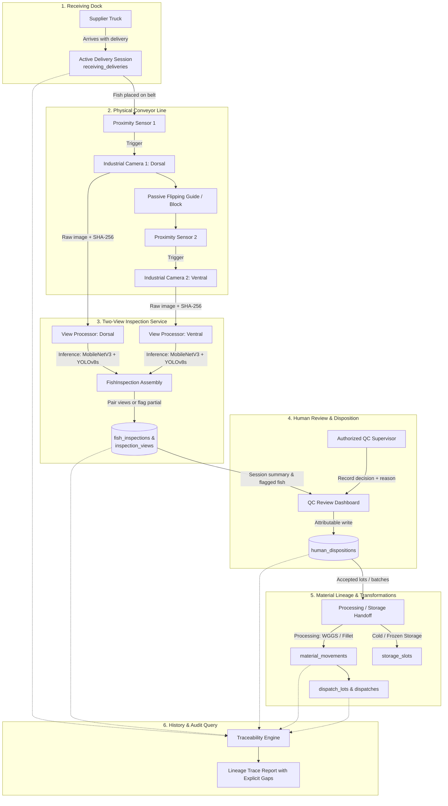

# NusaQC — Incoming Inspection and Traceable Factory Records

*   **Author:** Rkaaaa404
*   **Status:** Proposed
*   **Date:** 2026-11-07

---

## Overview

NusaQC is a fish-processing quality management system. Its scope is the moment fish arrive from a supplier through to their shipment or confirmed disposal. The system records inspection observations from AI-assisted cameras, links them to identifiable incoming deliveries, and preserves traceable relationships as material moves through processing, storage and shipment.

The core product is a retrievable, auditable evidence chain. AI assists QC staff with supported visible findings; it does not make final decisions. Every disposition, correction and handoff is recorded under a named person.

## The Problem

A fish processor receives incoming fish from multiple suppliers before processing them for export or domestic sale. Today, inspection results and material movements are recorded on paper or not at all. When a question arises about a lot's history — which supplier it came from, what QC found, how much was rejected and why — staff must reconstruct the answer from memory and scattered documents.

This creates four concrete gaps:

1. **No delivery-linked inspection record.** Inspection results exist per fish or per lot, but not reliably linked to the supplying delivery or its arrival time.
2. **AI observation and human decision are conflated.** The current system writes the final decision (PASS/FAIL/CONDITIONAL) back onto the inspection record, overwriting the original model output when a supervisor overrides it.
3. **No quantity accounting through transformations.** Processing changes fish count and mass. There is no record of what entered processing, what came out, what was set aside as normal yield, and what was recorded as a final loss.
4. **History is not retrievable under time pressure.** The proposal targets a five-minute delivery lookup; that is a goal, not a measured current capability.

The system must close these gaps without requiring individual-fish tracking hardware, replacing production planning systems, or asserting food-safety verdicts.

## Goals

*   Record each supplier delivery as an identifiable unit with its own ID, supplier, species, arrival time and received quantity.
*   Capture two-view inspections (dorsal and ventral) linked to that delivery, with model findings and coverage status preserved separately per view.
*   Record a human disposition separately from the AI observation: who decided, for which quantity, to what outcome, and why.
*   Preserve traceable links when material splits, enters processing or moves to storage.
*   Make gaps visible: missing views, incomplete evidence and unknown sources must be surfaced, not silently treated as a pass.
*   Enable retrieval of a delivery's complete evidence chain, including gaps, within the working session.
*   Provide a basis for measuring documentation completeness, retrieval time and quantity outcomes during a bounded pilot.

## Non-Goals

*   Automatic disposal or rejection based on AI findings alone.
*   Definitive disease diagnosis or food-safety certification of any kind.
*   Market eligibility rules (export vs. domestic) derived automatically from grades.
*   Supplier settlement, financial liability or cost attribution.
*   Size measurement or inspection of species outside the current model's confirmed scope.
*   Replacing production planning (PPIC), purchasing or accounting systems.
*   Handheld or supplier-side inspection hardware.
*   Claiming or projecting specific financial savings.
*   Recall Room or Switch workflow design.

## Open Questions

*   **Q1 — Turning mechanism:** Is a suitable passive flipping device commercially available for wet fish at the target conveyor speed and size range? What is the failure rate, and how are misflipped or jammed fish handled without blocking the line?
*   **Q2 — Delivery identity in practice:** When a delivery is partly held in cold storage and partly sent directly to processing, how do staff maintain the shared delivery ID across both paths at the same time?
*   **Q3 — Decision authority:** Which role in the factory (QC supervisor, PPIC manager, or another) holds the authority to record an acceptance, rejection, downgrade or reprocessing decision? Is this different for different defect types?
*   **Q4 — Quantity units:** Does the factory measure receiving quantities in fish count, weight, or both? What unit governs supplier agreements and loss calculations?
*   **Q5 — Existing records:** Can the original `nusaqc.db` inspection records be retained as historical observations without being promoted to receiving-linked, quantity-bearing records? Or must they be migrated?
*   **Q6 — Deployed model labels:** What are the exact defect labels the current YOLOv8s model detects? This determines what findings the system can honestly report.
*   **Q7 — Retention and backup:** What retention period applies to inspection photographs? Who owns the backup and recovery process, and where is the backup stored?

## Critical User Journeys (CUJs)

### CUJ 1: Register an incoming delivery and begin inspection

*   **Given:** A supplier truck has arrived. No delivery record exists for this arrival yet. The QC operator is at the inspection station.
*   **When:** The operator opens NusaQC, creates a new delivery record with the supplier name, species, arrival time and received quantity, then starts the inspection session linked to that delivery.
*   **Then:** Each fish passing the conveyor produces one two-view inspection record (dorsal capture, then ventral capture after turning). Both views are linked to the same fish inspection, which is linked to the delivery. Missing or unreadable views are flagged incomplete. The inspection count increments independently of view count.

### CUJ 2: Review AI findings and record a human disposition

*   **Given:** An inspection session for a delivery is complete. Some fish have one or more model findings (e.g., a defect label with bounding box and confidence). Some inspections are marked incomplete.
*   **When:** A QC supervisor reviews the session summary, examines flagged fish and their photographs, and records a disposition for a defined quantity: accepted, rejected, to be reprocessed, or downgraded.
*   **Then:** The disposition record stores the supervisor's identity, the affected quantity and unit, the outcome, the reason, and the timestamp. The original AI findings and photographs remain unchanged. The disposition does not rewrite the model output.

### CUJ 3: Trace a delivery through storage and dispatch

*   **Given:** A delivery was accepted two days ago and partially sent to cold storage, partially to processing. A question arises about which shipment contains fish from that delivery.
*   **When:** A staff member searches for the delivery by ID or supplier name and date.
*   **Then:** The system shows the delivery record, its linked inspections, the human disposition, the storage slot(s) assigned, and the dispatch record(s) containing lots from that delivery. Gaps (missing links, unknown sources) are shown explicitly. No inference is made for missing links.

### CUJ 4: Record a processing handoff and quantity outcome

*   **Given:** A batch of accepted fish from a delivery enters processing for WGGS (Whole, Gilled, Gutted, and Scaled) or filleting.
*   **When:** The operator records the processing event: input delivery/lot ID, input quantity, output quantity, normal processing removal, any QC-rejected portion and any unexplained variance.
*   **Then:** The system stores a transformation record linking the input delivery to its outputs. Fish count and weight are recorded in agreed units; they are not automatically converted. The processing record is separate from the inspection and disposition records.

## Technical Plan (Architecture)

### System Architecture & Boundaries

NusaQC extends the existing FastAPI and SQLite architecture to enforce strict boundaries between automated optical inspection, human quality disposition, and material transformation accounting.



### Data Model & Relational Schema

The SQLite schema is expanded with five purpose-built tables that leave legacy inspection rows intact as historical observations:

1. **`receiving_deliveries`**: Represents one arrival from a supplier.
   * `id` (`VARCHAR(64)` PK): Format `DEL-YYYYMMDD-XXX`.
   * `supplier_name` (`VARCHAR(255)` NOT NULL): Name of supplier/transporter.
   * `species` (`VARCHAR(128)` NOT NULL): e.g., Tilapia, Yellowfin Tuna, Skipjack.
   * `fish_family` (`VARCHAR(64)` NOT NULL): e.g., Scombridae, Cichlidae.
   * `received_at` (`DATETIME` NOT NULL): Arrival timestamp.
   * `stated_quantity` (`FLOAT` NOT NULL): Delivery quantity as declared on intake.
   * `quantity_unit` (`VARCHAR(16)` NOT NULL): `kg` or `count`.
   * `truck_identifier` (`VARCHAR(64)` NULL): License plate or container number.
   * `status` (`VARCHAR(32)` NOT NULL): `active_receiving`, `inspection_complete`, `disposition_recorded`, `closed`.
   * `created_by` (`VARCHAR(64)` NOT NULL): Intake operator identifier.

2. **`fish_inspections`**: Represents an individual fish passing the inspection station.
   * `id` (`INTEGER` PK AUTOINCREMENT).
   * `delivery_id` (`VARCHAR(64)` NOT NULL FK -> `receiving_deliveries.id`).
   * `sequence_in_delivery` (`INTEGER` NOT NULL): 1-indexed sequential counter within delivery.
   * `status` (`VARCHAR(32)` NOT NULL): `COMPLETE` (both views captured), `PARTIAL_DORSAL_ONLY`, `PARTIAL_VENTRAL_ONLY`, `FAILED_CAPTURE`.
   * `flagged_for_review` (`BOOLEAN` NOT NULL DEFAULT FALSE): Set true if either view has grade C or any detected defect.
   * `flag_reasons_json` (`TEXT` NULL): Array of detected defect classes (e.g. `["ulcer", "scale_loss"]`).
   * `created_at` (`DATETIME` NOT NULL).

3. **`inspection_views`**: Stores evidence and model observations per side.
   * `id` (`INTEGER` PK AUTOINCREMENT).
   * `fish_inspection_id` (`INTEGER` NOT NULL FK -> `fish_inspections.id`).
   * `view_side` (`VARCHAR(16)` NOT NULL): `dorsal` or `ventral`.
   * `image_path` (`VARCHAR(512)` NOT NULL): Relative path on local filesystem.
   * `sha256` (`CHAR(64)` NOT NULL): Integrity checksum of stored image artifact.
   * `freshness_grade` (`VARCHAR(16)` NOT NULL): `A`, `B`, `C`, or `UNSUPPORTED`.
   * `freshness_confidence` (`FLOAT` NOT NULL): Model confidence score ($0.0 - 1.0$).
   * `defects_detected_json` (`TEXT` NOT NULL): Serialized array of `{label, confidence, bounding_box: [x1, y1, x2, y2]}`.
   * `inference_mode` (`VARCHAR(32)` NOT NULL): `real_onnx` or `simulated_mock`.
   * `inference_latency_ms` (`INTEGER` NOT NULL): Processing latency in milliseconds.
   * `created_at` (`DATETIME` NOT NULL).

4. **`human_dispositions`**: The authoritative human QC decision.
   * `id` (`INTEGER` PK AUTOINCREMENT).
   * `delivery_id` (`VARCHAR(64)` NOT NULL FK -> `receiving_deliveries.id`).
   * `output_lot_id` (`VARCHAR(64)` NULL): Target lot identifier assigned for downstream tracking.
   * `disposition` (`VARCHAR(32)` NOT NULL): `ACCEPT`, `REJECT`, `REPROCESS`, `DOWNGRADE`.
   * `affected_quantity` (`FLOAT` NOT NULL): Quantity affected by this decision.
   * `quantity_unit` (`VARCHAR(16)` NOT NULL): Unit matching or converted from delivery.
   * `decision_reason` (`TEXT` NOT NULL): Operational or commercial rationale.
   * `authorized_by` (`VARCHAR(64)` NOT NULL): Authenticated username/badge of the supervisor.
   * `decided_at` (`DATETIME` NOT NULL).

5. **`material_movements`**: Journal of physical transformations and custody handoffs.
   * `id` (`INTEGER` PK AUTOINCREMENT).
   * `delivery_id` (`VARCHAR(64)` NOT NULL FK -> `receiving_deliveries.id`).
   * `input_ref` (`VARCHAR(64)` NOT NULL): Parent delivery ID or upstream movement ID.
   * `output_lot_id` (`VARCHAR(64)` NOT NULL): Produced lot ID (connects to `storage_slots.lot_id` or `dispatch_lots.lot_id`).
   * `stage` (`VARCHAR(64)` NOT NULL): `receiving_to_storage`, `receiving_to_processing`, `processing_wggs`, `processing_fillet`, `storage_to_processing`, `processing_to_dispatch`.
   * `quantity_in` (`FLOAT` NOT NULL): Material quantity entering the stage.
   * `quantity_out` (`FLOAT` NOT NULL): Salable / usable output quantity exiting the stage.
   * `quantity_unit` (`VARCHAR(16)` NOT NULL): Unit of measure (`kg` or `count`).
   * `normal_yield_loss` (`FLOAT` NOT NULL DEFAULT 0.0): Expected biological/processing removal (gills, viscera, and scales for WGGS; head, bones, and skin for fillet).
   * `qc_reject_loss` (`FLOAT` NOT NULL DEFAULT 0.0): Material discarded during this stage due to defects.
   * `unexplained_variance` (`FLOAT` NOT NULL DEFAULT 0.0): Discrepancy between input and accounted outputs.
   * `operator_id` (`VARCHAR(64)` NOT NULL): Staff member recording the movement.
   * `timestamp` (`DATETIME` NOT NULL).
   * `notes` (`TEXT` NULL).

### Two-View Conveyor Ingestion Pipeline

1. **Session Inception**: Operator initializes delivery via `POST /api/v1/deliveries`. Backend sets station context in memory and opens active capture directory `/data/captures/{delivery_id}/`.
2. **First Trigger (Dorsal)**: Sensor 1 pulses on fish arrival. Camera 1 captures frame. Background thread:
   * Computes SHA-256 and writes image to disk.
   * Allocates `fish_inspections` row with `sequence_in_delivery = N`.
   * Executes MobileNetV3 (eye/gill ROI) and YOLOv8s on dorsal frame.
   * Writes `inspection_views` row for `view_side = dorsal`.
   * Sets pairing timeout timer (3.0s).
3. **Passive Inversion Stage**: Fish moves through a passive physical inverter guide intended to orient the fish onto its ventral side (subject to mechanical qualification under Open Question Q1; anomalous orientations or jams fall back to Step 5).
4. **Second Trigger (Ventral)**: Sensor 2 pulses. Camera 2 captures frame. Background thread:
   * Cancels timeout timer for sequence `N`.
   * Computes SHA-256 and writes ventral image to disk.
   * Executes MobileNetV3 and YOLOv8s on ventral frame.
   * Writes `inspection_views` row for `view_side = ventral`.
   * Evaluates aggregate flags: if either view shows Grade C or $\ge 1$ surface defect, marks `fish_inspections.flagged_for_review = TRUE`.
   * Sets `fish_inspections.status = COMPLETE`.
5. **Timeout & Anomaly Fallback**: If Sensor 2 does not fire within 3.0 seconds after Sensor 1:
   * Sequence `N` status is set to `PARTIAL_DORSAL_ONLY`.
   * The inspection is flagged for manual supervisor inspection.
   * The station does not crash or halt conveyor motor; anomaly is recorded with explicit partial inspection status and zero synthetic assumptions.

### API Endpoints (FastAPI Backend)

* `POST /api/v1/deliveries`: Start receiving delivery session. Request body: `{supplier_name, species, fish_family, stated_quantity, quantity_unit, truck_identifier}`.
* `GET /api/v1/deliveries`: List deliveries with summary counts (total inspected, flagged count, partial count, current status).
* `GET /api/v1/deliveries/{id}`: Detailed delivery view with paginated inspection sequence list, flags, views, dispositions, and movements.
* `POST /api/v1/deliveries/{id}/capture-view`: Internal hardware/trigger endpoint for camera image upload and sequential processing.
* `POST /api/v1/deliveries/{id}/dispositions`: Record human QC disposition. Request body: `{output_lot_id, disposition, affected_quantity, quantity_unit, decision_reason, authorized_by}`.
* `POST /api/v1/deliveries/{id}/movements`: Record material handoff/transformation. Request body: `{input_ref, output_lot_id, stage, quantity_in, quantity_out, quantity_unit, normal_yield_loss, qc_reject_loss, unexplained_variance, operator_id, notes}`.
* `GET /api/v1/deliveries/{id}/trace`: Return the complete end-to-end lineage tree from delivery intake through storage slots and export dispatches, explicitly returning an array of `missing_links` where data gaps exist.

### Non-Functional Requirements

#### 1. Security & Attributability
* Every disposition and material movement record requires an authenticated `authorized_by` or `operator_id`.
* Image artifacts are append-only. Deletion of historical inspection images is disabled while referenced by an open delivery, disposition, or dispatch record.
* SHA-256 checksums are verified on image read to detect filesystem corruption.

#### 2. Performance & Capacity Envelope
* **Inference Overhead**: Sequential MobileNetV3 (150–300 ms) + YOLOv8s (470 ms) yields ~650–800 ms total CPU execution per frame on target hardware (Raspberry Pi 5 / x86 CPU). Total two-view inference execution is ~1.5 s per fish.
* **Storage Budget**: Assuming 300 KB compressed JPEG per view $\times$ 2 views = 600 KB per fish. For a 1,000-fish delivery, image footprint is ~600 MB. Storage volume must enforce a pre-capture check requiring at least 10 GB free disk space before initiating an active delivery session.
* **Zero Token Budget**: The core inspection and record-keeping pipeline runs entirely on local vision models and deterministic SQL; zero external LLM tokens are consumed.

#### 3. Rollout, Backward Compatibility & Rollback
* **Additive Migration**: The five new tables are created via SQLAlchemy metadata without modifying columns in existing `inspections`, `storage_slots`, or `dispatches` tables.
* **Historical Data Isolation**: Existing rows in `inspections` retain their historical values. They are marked as `legacy_observation` records and not synthesized into artificial delivery sessions.
* **Operational Recovery**: If hardware or power fails during a delivery, restarting the backend inspects the active delivery's highest sequence number and resumes numbering from $N+1$. Manual paper tally sheets during outages are ingested as a single reconciliation movement record with explicit `manual_outage_reconciliation` tag.


### Risks & Mitigations

1. **Conveyor Inversion Failure & Physical Desynchronization**:
   * *Risk*: Wet fish slip, jam, or fail to invert 180 degrees in the passive guide block; sensor spacing variations cause ventral triggers to arrive late or not at all.
   * *Mitigation*: The software evidence model is decoupled from physical timing. Sensor 2 captures that do not fire within 3.0 seconds are recorded as `PARTIAL_DORSAL_ONLY` without advancing the correlation index or attributing the next fish's ventral view to sequence $N$. The system also supports an operator-assisted trigger mode for validation pilot runs.

2. **Material Quantity Overdraw Across Split Paths**:
   * *Risk*: Material entering multiple downstream transformation stages (e.g., storage and filleting) exceeds the quantity declared at intake.
   * *Mitigation*: `record_transformation_stage` executes an atomic balance check in SQLite: $\sum(\text{quantity\_in}) \le \text{delivery.stated\_quantity}$. Any attempt to log movements exceeding available intake balance is rejected with HTTP 422.

3. **SQLite Concurrency & Lock Contention**:
   * *Risk*: High-frequency camera trigger ingestion simultaneous with operator disposition updates causes database locking contention (`sqlite3.OperationalError: database is locked`).
   * *Mitigation*: SQLite is configured with Write-Ahead Logging (`PRAGMA journal_mode=WAL;`), synchronous normal, and a 30.0-second busy timeout in SQLAlchemy `create_engine`. High-frequency camera view persistence is bounded by an asynchronous semaphore (`asyncio.Semaphore(4)`).

4. **Edge Hardware CPU Saturation**:
   * *Risk*: Rapid successive conveyor triggers spawn unbounded background threads running MobileNetV3 and YOLOv8s simultaneously, causing CPU thermal throttling on Raspberry Pi hardware.
   * *Mitigation*: Sequential execution per frame (MobileNetV3 eye/gill crop first, then YOLOv8s full-frame) bounded by an edge worker semaphore. Incoming frame buffers are limited to a queue depth of 8 frames before applying backpressure.

5. **Attributability & Historical Decision Modification**:
   * *Risk*: Operators supply arbitrary badge strings or attempt to rewrite historical decisions.
   * *Mitigation*: Dispositions record authenticated session identities. When an operator corrects an earlier decision, the system appends a new record referencing `supersedes_id` rather than updating or deleting historical rows.
## Alternatives Considered

### Alternative A: Automated Direct Loss (Every Model Defect Triggers Automatic Disposal)

*   **Pros**: Simple closed-loop mechanical logic; stops the conveyor immediately on any model defect detection without human intervention.
*   **Cons**: Conflates visual screening observations with definitive food-safety hazards; discards salvageable fish that can be reprocessed into fillets or downgraded to domestic markets; imposes unverified financial loss on either the factory or supplier without contractual backing.
*   **Reason for Rejection**: Rejected by author: real-world factory interviews confirmed that defects are evaluated against agreed supplier tolerances and dispositioned flexibly (e.g., trimming into fillets or selling in domestic tiers). Automated disposal destroys salable material and removes necessary human oversight.

### Alternative B: Individual Fish Tagging (RFID / Barcodes) Across All Processing Lines

*   **Pros**: Unambiguous, unbroken tracking of every individual fish through every processing station.
*   **Cons**: Prohibitive physical and labor cost; physical tags cannot survive descaling, evisceration (WGGS), and filleting operations where fish are cut and divided; high risk of foreign body contamination if physical tags fall into food lines.
*   **Reason for Rejection**: Rejected by author: tracking at the individual fish level throughout processing is physically impractical and economically unviable. Traceability must operate at the level of distinct delivery lots and physical handling containers.

### Alternative C: Full Factory ERP & Inventory Management Replacement

*   **Pros**: Single monolithic system for purchasing, inventory, production scheduling (PPIC), cost accounting, and quality.
*   **Cons**: Huge development and deployment surface; high barrier to adoption for mid-sized fish processing units; duplicates existing plant accounting software.
*   **Reason for Rejection**: Rejected by author: NusaQC must remain a focused quality inspection and material lineage system. It must interface cleanly with existing plant operations rather than attempting an expensive, high-risk ERP overhaul.

### Alternative D: Handheld Optical Inspection Gun for Upstream Farmer/Boat Purchasing

*   **Pros**: Enables the first-line supplier or factory buyer to inspect fish at the pond or dock before purchasing.
*   **Cons**: Highly variable optical environment (uncontrolled lighting, severe water glare without fixed polarizing filters, motion blur); requires wireless field synchronization and battery-constrained edge compute.
*   **Reason for Rejection**: Deferred by author: the optical geometry and dual-view conveyor pipeline must be proven and validated in a controlled factory receiving environment before tackling uncontrolled mobile field inspection.

### Alternative E: Proceeding Directly to Incident Response Workflow (Recall Room / Switch)

*   **Pros**: Immediately models buyer complaint escalation and multi-party room coordination across QA, operations, and logistics.
*   **Cons**: Building containment and hold enforcement before the underlying plant records (receiving batches, two-view evidence, and transformation lineage) actually exist creates an audit workflow with no data to trace.
*   **Reason for Rejection**: Deferred by author: the foundational data model, two-view ingestion pipeline, and material movement tracking must be formalized first so any future recall workflow acts on real, verifiable database records.

### Alternative F: Paper Tally Sheets and Manual Photo Folders

*   **Pros**: Zero software development cost; familiar to existing plant workers.
*   **Cons**: High search latency during buyer audits; photos frequently separated from tally records; no automated anomaly detection; vulnerable to silent record loss.
*   **Reason for Rejection**: Retained as the baseline comparison case (not outright rejected). NusaQC's incremental adoption must be measured against this manual baseline during pilot trials to verify whether the digital system justifies its operational effort.

## Detailed Implementation Plan

### Implementation Sequence

Execution proceeds in eight discrete, verifiable phases:
1. **Schema & Models**: Add SQLAlchemy models in `backend/app/models/delivery_trace.py` and export in `backend/app/models/__init__.py`.
2. **Pydantic Validation**: Add schemas for deliveries, views, dispositions, and movements in `backend/app/schemas/delivery_trace.py`.
3. **Two-View Ingestion Service**: Build camera pairing, timeout timer, SHA-256 calculation, and partial-status fallback in `backend/app/services/two_view_inspection_service.py`.
4. **Lineage & Audit Engine**: Build transformation journaling and backward/forward graph traversal with explicit gap detection in `backend/app/services/material_lineage_service.py`.
5. **API Endpoints**: Implement REST routes in `backend/app/api/v1/deliveries.py` and mount onto router in `backend/app/api/v1/router.py`.
6. **Hardware Ingestion & Mock Simulation**: Extend hardware controllers in `backend/app/hardware/dual_conveyor_controller.py` to simulate dual proximity sensors and flipping delays.
7. **Frontend Operations UI**: Add TypeScript types in `frontend/types/delivery.ts`, API methods in `frontend/lib/api.ts`, and delivery/lineage pages under `frontend/app/deliveries/`.
8. **Test Automation**: Add full unit and end-to-end regression suites in `backend/tests/test_delivery_traceability.py` and `backend/tests/test_material_lineage.py`.

### Target Files to Create/Modify

#### 1. `backend/app/models/delivery_trace.py` (Create)
*   **Type / Scope**: SQLAlchemy ORM Models / Backend Persistence.
*   **Rationale**: Defines the 5 new relational entities: `ReceivingDelivery`, `FishInspection`, `InspectionView`, `HumanDisposition`, and `MaterialMovement`.
*   **Key Declarations**:
    *   Foreign key relationships linking `InspectionView` $\rightarrow$ `FishInspection` $\rightarrow$ `ReceivingDelivery`.
    *   Enums for `ViewSide` (`dorsal`, `ventral`), `InspectionStatus` (`COMPLETE`, `PARTIAL_DORSAL_ONLY`, `PARTIAL_VENTRAL_ONLY`, `FAILED_CAPTURE`), `DispositionOutcome` (`ACCEPT`, `REJECT`, `REPROCESS`, `DOWNGRADE`), and `ProcessingStage` (`receiving_to_storage`, `receiving_to_processing`, `processing_wggs`, `processing_fillet`, `storage_to_processing`, `processing_to_dispatch`).
    *   Indexed lookup columns on `delivery_id`, `output_lot_id`, and `created_at`.

#### 2. `backend/app/models/__init__.py` (Modify)
*   **Type / Scope**: Backend Package Configuration.
*   **Rationale**: Exposes the new delivery and lineage models so FastAPI's `init_db()` automatically registers metadata and initializes missing tables on startup without requiring an external migration runner.

#### 3. `backend/app/schemas/delivery_trace.py` (Create)
*   **Type / Scope**: Pydantic Validation Schemas / API Contracts.
*   **Rationale**: Enforces input validation and serializes structured JSON responses for intake sessions, dual captures, human quality decisions, and material transformations.
*   **Key Declarations**:
    *   `DeliveryCreate`: Validates supplier name, fish family, received quantity ($> 0$), and unit (`kg` or `count`).
    *   `CaptureViewInbound`: Internal payload schema carrying raw image buffer, side (`dorsal`/`ventral`), and hardware trigger timestamp.
    *   `HumanDispositionCreate`: Validates supervisor badge/ID, affected quantity, decision outcome, and non-empty rationale.
    *   `MaterialMovementCreate`: Validates stage name, input reference, output lot ID, quantity balances (`quantity_in`, `quantity_out`, `normal_yield_loss`, `qc_reject_loss`, `unexplained_variance`), and requires that inputs equal outputs within declared variance.
    *   `DeliveryTraceTreeResponse`: Serializes hierarchical graph of deliveries, dual-view inspections, dispositions, processing runs, assigned storage slots, and dispatches, explicitly returning an array of unresolved gaps.

#### 4. `backend/app/services/two_view_inspection_service.py` (Create)
*   **Type / Scope**: Core Backend Application Service.
*   **Rationale**: Encapsulates the stateful logic of correlating Sensor 1 (dorsal) and Sensor 2 (ventral) captures for each passing fish.
*   **Key Declarations & Logic**:
    *   `handle_view_capture(db: Session, delivery_id: str, view_side: str, image_bytes: bytes) -> FishInspection`: Computes SHA-256, writes image to `/data/captures/{delivery_id}/`, invokes inference sequentially via `app.ai.inference`, and matches with existing sequence or opens new sequence.
    *   `reap_timed_out_captures(db: Session, timeout_seconds: float = 3.0)`: Background asyncio task that transitions orphan dorsal captures older than 3 seconds to `PARTIAL_DORSAL_ONLY` and sets `flagged_for_review = TRUE`.

#### 5. `backend/app/services/material_lineage_service.py` (Create)
*   **Type / Scope**: Backend Lineage & Traceability Engine.
*   **Rationale**: Computes material balances across WGGS and filleting lines and executes recursive SQLite queries to reconstruct full provenance trees for buyer audits.
*   **Key Declarations & Logic**:
    *   `record_transformation_stage(db: Session, payload: MaterialMovementCreate) -> MaterialMovement`: Verifies input lot existence, validates mass/count balance, and writes immutable journal entry.
    *   `get_delivery_audit_trail(db: Session, delivery_id: str) -> DeliveryTraceTreeResponse`: Queries upstream delivery data, correlates all dual views, extracts supervisor dispositions, traces downstream `material_movements` into `storage_slots` and `dispatch_lots`, and isolates any lots with missing upstream receiving links.

#### 6. `backend/app/api/v1/deliveries.py` (Create)
*   **Type / Scope**: FastAPI Route Handlers.
*   **Rationale**: Exposes REST endpoints for the receiving dock, conveyor triggering, QC review, and export audit queries.
*   **Key Endpoints**:
    *   `POST /`: Initialize active receiving delivery.
    *   `GET /`: Paginated list of deliveries with summary metrics.
    *   `GET /{id}`: Full delivery overview, inspection sequence progress, and disposition summary.
    *   `POST /{id}/capture-view`: Camera trigger ingestion endpoint.
    *   `POST /{id}/dispositions`: Authoritative human QC disposition recording.
    *   `POST /{id}/movements`: WGGS / Fillet processing handoff and yield journal recording.
    *   `GET /{id}/trace`: End-to-end lineage retrieval with explicit data gaps array.

#### 7. `backend/app/api/v1/router.py` (Modify)
*   **Type / Scope**: Backend API Router Aggregator.
*   **Rationale**: Registers `deliveries.router` under `/api/v1/deliveries` alongside legacy routes (`/inspections`, `/lots`, `/storage`, `/dispatch`, `/settings`).

#### 8. `backend/app/hardware/dual_conveyor_controller.py` (Create)
*   **Type / Scope**: Hardware Ingestion & Mock Driver.
*   **Rationale**: Extends existing `gpio_controller.py` and `mock_controller.py` to drive both proximity sensors, control the conveyor motor, and emit mock Sensor 1 and Sensor 2 events with realistic physical transit delays (0.8s to 1.5s) through the passive inverter guide.

#### 9. `frontend/types/delivery.ts` (Create)
*   **Type / Scope**: Frontend TypeScript Type Definitions.
*   **Rationale**: Mirrors backend Pydantic schemas for `ReceivingDelivery`, `FishInspection`, `InspectionView`, `HumanDisposition`, `MaterialMovement`, and `DeliveryTraceTree`.

#### 10. `frontend/lib/api.ts` (Modify)
*   **Type / Scope**: Frontend HTTP API Client.
*   **Rationale**: Adds type-safe client methods: `createDelivery()`, `getDeliveries()`, `getDeliveryById()`, `recordDisposition()`, `recordMovement()`, and `getDeliveryTrace()`.

#### 11. `frontend/app/deliveries/page.tsx` (Create)
*   **Type / Scope**: Next.js React Dashboard Page.
*   **Rationale**: Intake dock interface for truck registration, starting/stopping active delivery sessions, and viewing real-time conveyor inspection totals.

#### 12. `frontend/app/deliveries/[id]/page.tsx` (Create)
*   **Type / Scope**: Next.js React Inspection & QC Detail Page.
*   **Rationale**: Detailed workspace for QC supervisors: displays side-by-side dorsal/ventral image previews, bounding boxes, highlighted defect tags, partial capture warnings, human disposition action modal, and WGGS/Fillet yield logging forms.

#### 13. `frontend/app/deliveries/[id]/trace/page.tsx` (Create)
*   **Type / Scope**: Next.js React Lineage Visualization Page.
*   **Rationale**: Audit visualization page rendering the interactive provenance tree from delivery through storage slots and export dispatches, prominently badging unresolved gaps in red.

#### 14. `frontend/components/layout/Sidebar.tsx` (Modify)
*   **Type / Scope**: Frontend Navigation Component.
*   **Rationale**: Adds a top-level "Receiving & Trace" navigation link pointing to `/deliveries`.

#### 15. `backend/tests/test_delivery_traceability.py` (Create)
*   **Type / Scope**: Backend Pytest Test Driver.
*   **Rationale**: Exercises unit and integration scenarios for intake, dual-view correlation, timeout fallbacks, and human disposition immutability.

#### 16. `backend/tests/test_material_lineage.py` (Create)
*   **Type / Scope**: Backend Pytest Test Driver.
*   **Rationale**: Verifies mass/count balancing across WGGS scaling and filleting handoffs, recursive audit retrieval, and detection of missing upstream links.

#### 17. `docs/DELIVERY_TRACEABILITY_GUIDE.md` (Create)
*   **Type / Scope**: Operational Documentation.
*   **Rationale**: Instructions for dock operators and QC supervisors detailing delivery creation, manual outage tally sheet reconciliation, and image retention/backup procedures.

### Verification Plan

#### 1. Compilation & Static Analysis
*   **Backend Linting & Typing**:
    ```sh
    uv run ruff check backend/app
    uv run python -m py_compile backend/app/models/delivery_trace.py backend/app/services/*.py
    ```
*   **Frontend Type Check & Build**:
    ```sh
    cd frontend && pnpm run build
    ```

#### 2. Automated Test Suite (Pytest)
Execute backend test suite targeting new modules:
```sh
uv run pytest backend/tests/test_delivery_traceability.py backend/tests/test_material_lineage.py -v
```
*   **Test Cases Covered**:
    1. `test_delivery_session_lifecycle`: Create delivery, verify status transitions from `active_receiving` to `closed`.
    2. `test_two_view_normal_pairing`: Simulate Sensor 1 dorsal capture, then Sensor 2 ventral capture within 1.0s; verify single `FishInspection` with status `COMPLETE` and two linked `InspectionView` rows.
    3. `test_two_view_timeout_partial_fallback`: Trigger Sensor 1 without Sensor 2; verify timeout marks inspection as `PARTIAL_DORSAL_ONLY` and sets `flagged_for_review = TRUE`.
    4. `test_flagged_inspection_criteria`: Verify that an inspection is flagged if either dorsal or ventral view exhibits Grade C freshness or $\ge 1$ surface defect.
    5. `test_human_disposition_immutability`: Record supervisor disposition; verify original inspection records and model outputs remain completely unaltered.
    6. `test_wggs_and_fillet_lineage_accounting`: Submit `material_movements` for WGGS scaling and filleting lines; verify that input equals outputs + normal yield loss + reject loss + unexplained variance.
    7. `test_audit_trace_with_missing_links`: Query `/api/v1/deliveries/{id}/trace` for lot with missing upstream receiving link; verify `missing_links` array isolates the gap explicitly without hallucinated connections.

#### 3. Test Coverage Requirement
*   Strict **85%+ branch coverage** across `backend/app/services/two_view_inspection_service.py` and `backend/app/services/material_lineage_service.py`.

#### 4. Manual End-to-End Smoke Scenario
1. Launch backend and frontend using `docker compose up --build`.
2. Navigate to `http://localhost:3000/deliveries` and create delivery `DEL-20261107-001` (Supplier: PT Samudra Bitung, Species: Tilapia, Family: Cichlidae, Stated: 500 kg).
3. Trigger 5 mock fish inspections with Mock Controller (including 1 partial capture and 1 ulcer-flagged fish).
4. In `http://localhost:3000/deliveries/DEL-20261107-001`, inspect the flagged fish, confirm two views are displayed side-by-side, and submit a human disposition (`ACCEPT` 450 kg, `REPROCESS` 50 kg for trimming).
5. Record a `processing_wggs` movement and a `processing_fillet` movement, noting normal biological removal.
6. Open `http://localhost:3000/deliveries/DEL-20261107-001/trace` and verify the complete lineage tree loads in $< 1.0$ second, with all physical handoffs and yield losses clearly displayed.

---

*Drafted with EGM*
