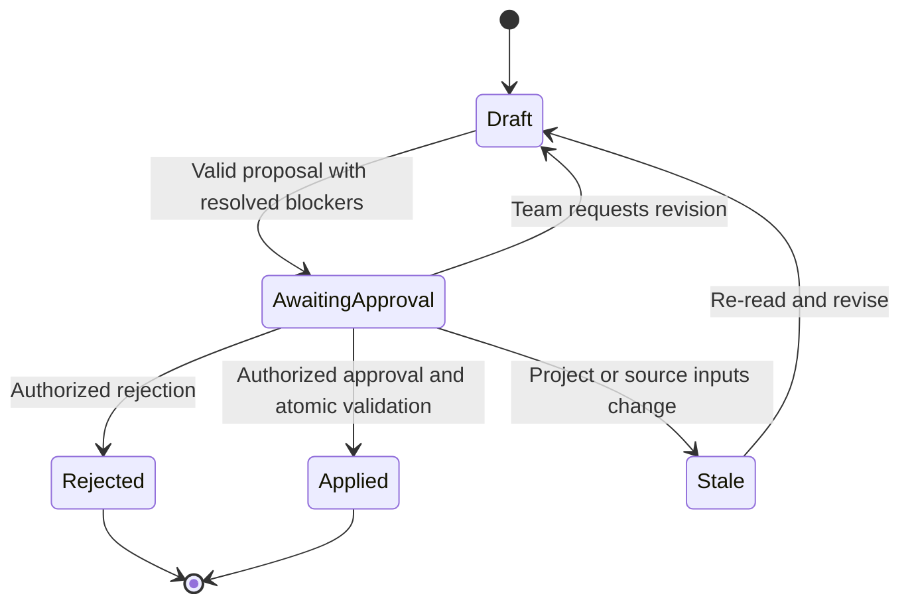
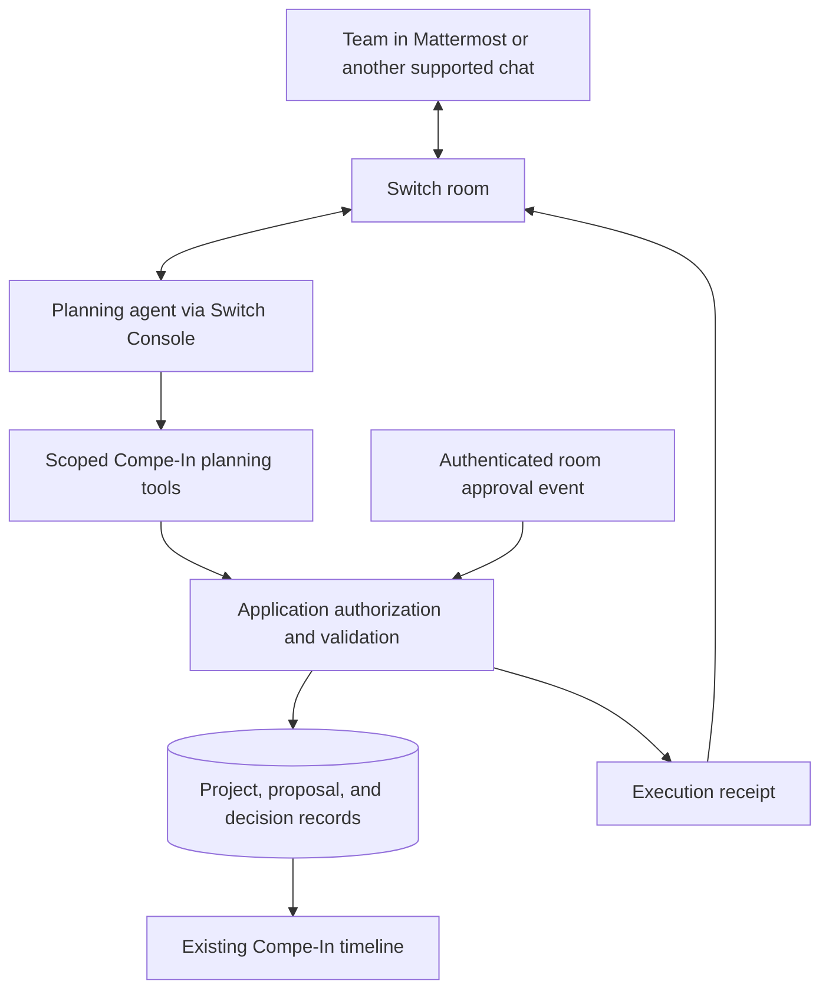

# Deadline Rescue Room

> A Switch-powered planning teammate that helps a competition team turn a deadline change or delivery setback into an agreed, executable schedule.

**Status:** Candidate idea, still being explored. Proposed product and implementation specification; not a claim that the integration exists.

**Target Switch version:** Switch Console **0.40.1**, which bundles switch-core **0.31.0** (from `artifacts.yaml` at tag `switch-console-v0.40.1`). Section 17 lists what was verified against that tag and what it changes, most importantly how approvals can be authenticated.

**Purpose:** This document is the single source of truth for the Deadline Rescue Room concept, its hackathon scope, and its expected behavior. It supersedes earlier conversational suggestions about this idea. `compe-in.md` describes the underlying Compe-In application; `competition-ideation.md` records competition context. Neither establishes that the functionality proposed here is implemented.

## 1. The idea in plain language

A hackathon team already has a plan: build a backend, connect the frontend, test the product, and prepare the submission. Then something changes. The organizer moves a deadline, a teammate becomes unavailable, or an important task takes longer than expected.

Today, the team discusses the problem in chat, edits a separate task board, and tries to remember which dates and scope decisions were actually agreed. Those systems drift apart.

Deadline Rescue Room brings the replanning conversation into one Switch room. An AI planning agent reads the current project, gathers constraints from teammates, and proposes a feasible revision. The team discusses the tradeoffs there. Once an authorized teammate explicitly approves the exact revision, the application applies it to the project timeline.

**The result is not another AI-generated plan in chat. It is an approved change to the actual project schedule, with a record of why the team made it.**

## 2. Who it is for

Primary user: a small student or independent team preparing a hackathon or technology-competition submission.

Participants:

- **Team lead / authorized editor:** reviews tradeoffs and approves schedule changes.
- **Teammates:** report availability, progress, blockers, and scope preferences.
- **Planning agent:** inspects the project, asks focused questions, and drafts revisions.

The initial implementation targets one team, one competition project, and one Switch room. It does not attempt organization-wide resource planning.

## 3. The problem

### The practical failure

The official deadline, the task timeline, and the team's conversation are separate sources of information. A change in one does not reliably propagate into the others.

Examples:

- Submission is earlier than the team originally planned for.
- A backend task slips, but its dependent integration task retains its old dates.
- Someone says they are unavailable, but their assigned work is unchanged.
- The team agrees to remove a feature, but it remains on the delivery plan.
- A revised schedule looks plausible while leaving no time to test or prepare the submission.

### Why ordinary reminders are insufficient

A reminder can say that the deadline is close. It cannot resolve competing priorities, obtain missing constraints from teammates, or safely apply an agreed change.

A standalone chatbot can suggest dates, but the team still has to translate its answer into real tasks and verify that it used current project data.

**The problem to solve is coordinated replanning—not deadline notification or generic task generation.**

## 4. The solution

Deadline Rescue Room provides a human-in-the-loop replanning workflow:

1. Someone reports a deadline change or delivery setback in the Switch room.
2. The agent reads the linked project's current tasks, dates, dependencies, and official stages.
3. It identifies known conflicts and asks for missing information.
4. It drafts a concrete schedule revision and explains the tradeoffs.
5. Teammates discuss or request changes in the room.
6. An authorized person explicitly approves the current proposal.
7. Application code validates and commits that proposal atomically.
8. The agent posts the result and links to the updated timeline.

The AI handles interpretation and discussion. Deterministic application code handles permissions, date rules, dependency validation, and committing changes.

## 5. A complete example

The following is an illustrative scenario, not a claim about the current competition's deadline.

### Starting situation

A team is building a competition submission. Its schedule includes backend work, frontend integration, testing, and submission preparation. Integration depends on the backend; testing depends on integration.

The team discovers that its recorded submission deadline is too late. A teammate also reports limited availability.

### Conversation and actions

**Team lead:**

> @planner The organizer says submission closes tomorrow at 8 PM WIB. Our project still targets the following day. Please help us replan. Here is the official announcement link.

**Agent:**

- Reads the current project and its schedule revision.
- Records the reported deadline with the source link, timezone, and verification status.
- Explains which tasks now extend beyond the proposed cutoff.
- Asks the affected teammate whether the backend estimate still holds.

**Teammate:**

> I can finish the core API tomorrow morning, but not social login. Keep email login and remove social login from this submission.

**Agent:**

- Prepares proposal `P-003`, revision 2.
- Moves the backend, integration, testing, and submission-preparation dates into a valid dependency order.
- Marks social login as excluded from this delivery without deleting the task.
- Shows what changed, which assumptions remain, and whether the plan fits.
- Requests confirmation of the deadline correction if it has not yet been verified.

**Team lead:**

> I verified the announcement. Approve P-003 revision 2.

**Application:**

- Verifies the approver's identity and workspace edit rights.
- Checks that the proposal and underlying project are unchanged.
- Validates the proposed dates and dependencies.
- Atomically applies the approved changes and records the decision.

**Agent:**

> Applied P-003 revision 2. Social login is excluded from this delivery; the revised schedule is saved. Here is the updated timeline and change summary.

### Important scheduling limitation

Compe-In's documented work-item dates are day-level values. The initial implementation must not claim to produce an hour-by-hour schedule from them. A task ending on the submission day is **not proof** that it finishes before an 8 PM cutoff.

For a same-day deadline, the proposal must explicitly flag intraday feasibility as unverified and request a human check. Deadline timestamps retain their exact time; task dates remain day-level. Hour-level task scheduling is outside the initial scope.

## 6. What makes Switch essential

Switch is the collaboration layer for this workflow, not an optional notification destination.

The room contains:

- Instructions defining the project's planning process.
- The team discussion that supplies availability and scope constraints.
- Agent questions and teammate answers.
- Proposal summaries and revision identifiers.
- Explicit approval of a specific revision.
- The execution result and decision summary.

The planning agent uses Switch to participate in that conversation and read the room context. The execution path requires an authorized approval originating from the associated room.

**Without Switch, this proposed conversation-to-approved-schedule workflow cannot execute.** The preexisting Compe-In catalog or manual timeline editor may still work; that does not make Switch optional to Deadline Rescue Room itself.

Switch does not provide Compe-In database credentials or automatically map chat users to application accounts. That integration is our responsibility.

## 7. What is authoritative

“Single source of truth” does not mean copying everything into chat. Each kind of information has one authoritative location:

| Information | Authority | Treatment elsewhere |
|---|---|---|
| Competition rules and deadlines | Organizer's official material | Store source, exact timestamp, and human verification status in Compe-In |
| Current task dates, assignments, and dependencies | Compe-In project database | Agent reads current values; room messages are summaries |
| Team constraints and discussion | Associated Switch room | Capture relevant messages in the proposal's rationale |
| Proposed changes | Versioned proposal record in the application | Room displays proposal ID and revision |
| Authorization | Application user identity and current workspace permissions | Room membership alone does not authorize writes |
| Applied change and approval evidence | Application decision/change record | Room receives a receipt and project link |

A pasted announcement is a reported source, not an automatically trusted deadline update. Contradictory sources require clarification; the agent must not silently select one.

## 8. Initial implementation scope

### Included

- Link one Switch room to one Compe-In competition project.
- Connect one planning agent through Switch Console.
- Read project tasks, dependencies, dates, and competition stages.
- Accept a human-reported deadline correction or delivery setback.
- Ask teammates for task-date commitments and scope decisions.
- Produce a versioned proposal with before/after changes.
- Support revision, rejection, and explicit approval.
- Validate and atomically apply approved schedule changes.
- Record delivery exclusions without deleting tasks.
- Show the updated plan in the existing timeline.
- Post an application-generated execution receipt to the room.

### Excluded

- Rebuilding the full Compe-In platform.
- Autonomous competition discovery or continuous announcement monitoring.
- Automatic competition registration or final submission.
- Generating or implementing the competition project's software.
- Multiple agents, cross-room orchestration, or organization-wide scheduling.
- Hour-by-hour resource optimization or inferred working calendars.
- Automatic reassignment without an explicit team decision.
- Treating an AI estimate as a guaranteed delivery commitment.

## 9. What a proposal must explain

Every proposal must make the decision reviewable before anyone approves it:

- Proposal ID and revision.
- Project revision used to prepare it.
- Trigger: what changed and who reported it.
- Deadline source, timezone, and verification status.
- Changed tasks with old and new dates.
- Existing dependency relationships affected by those changes.
- Explicitly agreed delivery exclusions.
- Relevant teammate commitments and their source messages.
- Remaining conflicts, assumptions, and unanswered questions.
- Feasibility assessment and its limits.

Do not present a schedule as feasible when dependency rules fail, required work extends past the deadline, or essential constraints are missing. If no acceptable schedule is available, explain the blocking work and ask for a scope decision. An infeasible proposal cannot be applied as a rescued plan.

Scope exclusions must be structured application data associated with the project/delivery. Putting “drop social login” only in a chat summary does not change the actual delivery plan.

## 10. Approval and execution rules

Approval is a state transition enforced by application code, not a sentence the model decides to trust.

Rules:

- Bind approval to the room, project, proposal ID, and proposal revision.
- Resolve the sender using authenticated Switch identity, not a typed name or an agent's claim about the sender. At 0.40.1 the planning agent never receives that identity, so this needs one of the two approval designs in Section 17.
- Require an explicit mapping to a Compe-In user with current workspace edit rights.
- Approval must come from a human participant; an agent cannot approve its own plan.
- Any proposal edit invalidates previous approval.
- A changed underlying project makes the proposal stale; re-read and revise rather than overwrite newer work.
- Recheck permissions and constraints at commit time.
- Apply schedule changes, delivery exclusions, any approved deadline correction, and the decision record in one transaction.
- Repeated delivery of the same approval must not apply the proposal twice.
- If validation fails, leave the project unchanged and report the reason.
- A generic message such as “looks good” is not sufficient approval.

These rules are requirements for our implementation, not claims that Switch provides this application-specific approval mechanism out of the box.

## 11. Proposed architecture

### Responsibilities

**Switch:** transports the team conversation and supplies room context.

**Planning agent:** interprets requests, reads authorized project data, asks questions, drafts proposals, and explains results. It cannot bypass approval or perform arbitrary database writes.

**Compe-In application:** binds room/project/user identities, exposes scoped planning operations, validates proposals, enforces approval, and commits changes.

**Database:** stores authoritative project state, proposal revisions, delivery exclusions, approval evidence, and applied results. Existing row-level security and transaction conventions remain in force.

### Minimal logical operations

These are proposed internal tool contracts, not existing API names:

| Operation | Responsibility |
|---|---|
| Read project snapshot | Return permitted tasks, dependencies, stages, and current revision |
| Preview proposal | Validate a candidate change set and report conflicts without mutation |
| Save proposal revision | Persist the exact reviewable candidate and its assumptions |
| Apply approved proposal | Resolve authenticated approval, revalidate, and atomically commit |

A chat identity is not a Supabase session. Before implementing writes, establish a server-verified account-linking and approval-authentication path compatible with Compe-In's session-scoped authorization. Do not introduce a service-role bypass or accept model-supplied identity fields as proof.

### Time and scheduling rules

- Preserve exact deadline instants as UTC timestamps.
- Display explicit local timezones; use WIB in the Compe-In interface as documented.
- Never infer the timezone of an ambiguous deadline.
- Keep existing day-level task scheduling semantics unless deliberately extending the application.
- Enforce actual dependency constraints in application code, not only in the prompt.
- Preserve an explicit testing/submission-preparation task when it is part of the team's required work; do not hide it to make the plan appear to fit.

## 12. Reuse versus new work

The following reuse opportunities come from `compe-in.md`; their actual code and behavior must be inspected before implementation.

| Documented Compe-In capability | Role in this project |
|---|---|
| Competition stages and deadline data | Planning constraints |
| Workspaces and membership roles | Project access and approval rights |
| Tasks, dependencies, and Gantt timeline | Current plan and visible revised outcome |
| Collision preview and atomic schedule commit | Starting point for validation and safe mutation |
| Session-scoped Supabase access and RLS | Security boundary to preserve |

New work is the Switch integration, identity association, conversational planning tools, versioned proposals, delivery-exclusion representation, approval enforcement, and execution receipts. Existing read-only chatbot tools should not be assumed sufficient for this workflow.

## 13. Demo and acceptance criteria

### Primary demo

Use a real local Switch room and a real Compe-In project. A teammate reports a changed deadline and a task constraint. The agent reads the project, asks a necessary question, proposes a revision, and receives an explicit human approval. The application updates the actual timeline and posts a receipt.

Use a clearly labelled sample competition if real organizer changes are unavailable. Do not pretend the sample is a live announcement.

### Observable acceptance criteria

1. The agent's proposal uses the actual project's current task dates and dependencies.
2. At least one teammate response changes the proposed plan.
3. The proposal shows concrete before/after dates and any delivery exclusion.
4. Before approval, the project remains unchanged.
5. After authorized approval, the timeline and stored delivery scope match the approved revision.
6. An unauthorized participant cannot apply changes.
7. A proposal based on an outdated project revision is refused without overwriting newer work.
8. Duplicate approval delivery does not duplicate the commit.
9. A dependency violation or unresolved deadline ambiguity blocks application and leaves the project unchanged.
10. A same-day cutoff is not misrepresented as proven feasible by day-level task dates.
11. The receipt names the applied proposal and provides the updated project link.

Success means the team can move from a delivery problem to a consistent, human-approved project plan without manually transcribing the discussion into the timeline. Do not claim measured time savings until measured.

## 14. Hackathon fit

**Intended track:** Best Business Workflow. The product coordinates practical team work; organizer confirmation remains authoritative for eligibility.

| Judging criterion | Evidence the project should demonstrate |
|---|---|
| Use of Switch | Teammate constraints, proposal discussion, and approval flow through the room |
| Technical execution | Actual validated timeline mutation, reproducible setup, and clear failure handling |
| Creativity and impact | Competition-specific replanning that connects official cutoffs, scope decisions, and task dependencies |
| Presentation | One clear before/after scenario showing the problem, human decision, and saved result |

Existing Compe-In capabilities are supporting infrastructure. The Switch setup and collaborative workflow must be built during the event under the published reuse rules. Do not present preexisting platform functionality as newly built work.

## 15. Main risks and implementation gates

| Risk | Decision |
|---|---|
| Existing application differs from its description | Inspect and run it before relying on reuse |
| Switch setup does not work in the development environment | First prove one person can exchange messages with one agent in a room |
| No trustworthy room-sender to application-user mapping | Resolve before enabling schedule writes; prompt instructions are insufficient. Concrete options for 0.40.1 in Section 17 |
| Day-level tasks hide intraday deadline conflicts | Expose the limitation and require human verification; do not claim hourly optimization |
| Deadline source is contradictory or inaccessible | Keep it unverified and request confirmation rather than invent a value |
| Team changes the project while reviewing a proposal | Reject the stale proposal and regenerate from current state |
| Scope expands into the entire competition platform | Keep one room, one project, one agent, and one end-to-end rescue scenario |

## 16. Product summary

**Problem:** teams discuss deadline and availability changes in chat, but their actual project schedule remains outdated.

**Solution:** a Switch-room planning agent turns those discussions into a concrete revision that an authorized teammate reviews and approves before application code saves it.

**Core deliverable:** an updated, dependency-valid project timeline and delivery scope, backed by the exact human-approved proposal.

**Not the product:** a reminder bot, an autonomous project manager, or an AI that merely suggests a schedule.

## 17. Switch 0.40.1 compatibility check

Checked on 2026-11-06 by reading the Switch repository at tag `switch-console-v0.40.1` (commit `6ab2ff4`). Source and doc reads only; nothing was run against a live server.

### 17.1 Verified facts that affect Deadline Rescue

| Topic | What 0.40.1 does | Source |
|---|---|---|
| Agent protocol transport | Live connection is a **WebSocket** at `/agents/{id}/connection/ws`; SSE is kept only for agent-protocol revision 7 and older and is slated for removal; long poll is the fallback. This matches the note already in this document. The protocol doc at the tag still says SSE; the code is authoritative | `core/switch_core/bridges/agent/api/handlers.py` |
| What the planning agent sees | `[Switch] <name> (workspace <role>) addressed you in room <room_id> (message_id …, thread_id …)` plus the body inside nonce markers. **No participant id** | `console/packages/agent-providers/src/host/room-prompt.ts` |
| What a custom Switch client receives | `sender` (Switch participant id), `sender_name`, `sender_role` (`owner`/`admin`/`member`, **null for a chat account no Switch user has claimed**), `on_behalf_of`, `message_id`, `body`, `thread_id`; `room_id` on the envelope | `core/switch_core/bridges/agent/protocol/message_events.py`, `types.py` |
| Posting from an application | `POST /agents/{id}/message` with `{room_id, content}` and the agent's API key; no live connection needed | `handlers.py` |
| Registering a custom client | `POST /agents/register-known` with a registration token | `handlers.py` |
| Files from people to the agent | Downloaded into the agent's session directory: PNG, JPEG, WebP, PDF, text, Markdown, CSV, JSON; at most 8 per message, 10 MB each | `.../host/attachments.ts` |
| Providers | `claude`, `codex`, `opencode` only | `docs/TEMPLATES.md` |
| References | Registrable types: GitHub, Google Drive, Confluence, Jira. A reference grants no access | `docs/official/building/payments-room.md` |
| Identity claims | An unclaimed chat account matches no addressing rule | `docs/official/internals/identity-and-access.md` |
| Tasks | The task operations are "present but not ready for use" | `docs/official/internals/agent-protocol.md` |

### 17.2 What this changes in the spec

**1. The planning agent cannot authenticate an approval.** Section 10 requires resolving the approver from authenticated Switch identity. A Console-run agent only sees a display name and workspace role, so "Approve P-003 revision 2" reaching the agent proves nothing. Two designs meet the rule:

| | Option A: approval client in the room | Option B: approval in the Compe-In app |
|---|---|---|
| How | A small deterministic program (no LLM) registered as a custom Switch agent receives `@approver approve P-003 r2` with the Switch-issued `sender` id and calls Compe-In's apply endpoint with its own server credential plus that id. Compe-In maps the id to a Compe-In user and checks workspace edit rights | The agent posts a link to the proposal page; the team lead approves while logged in to Compe-In, under the existing Supabase session and RLS |
| Authentication strength | Good: Switch-issued sender id, mapped to a Compe-In user | Strongest: the app's own login |
| New code | Approval client, identity-link table, apply endpoint | Approval page and apply endpoint |
| Switch centrality | Approval happens in the room | Approval leaves the chat, which weakens "would it stop working without Switch?" |
| Scope impact | Adds a second (non-LLM) Switch participant; Section 8's "multiple agents" exclusion should read "multiple LLM agents" | None |

Option A fits the judging criteria better. Option B is the fallback if a custom client proves hard to run on 0.40.1.

**2. Linking chat identities to Compe-In users (Option A).** A logged-in Compe-In user generates a short single-use code in the app, then posts `@approver link <code>` in the room. The approval client binds that message's `sender` id to the Compe-In user who generated the code. Refuse any command whose `sender_role` is null (unclaimed account).

**3. Receipts are application-generated.** After a commit, Compe-In posts the receipt itself through `POST /agents/{id}/message` with the approval client's key, so the receipt is never an LLM paraphrase. The planning agent may add an explanation afterwards.

**4. The planning agent is a Console agent, not Compe-In's Gemini chatbot.** Compe-In's existing AI tools run inside the Next.js app with the user's session and cannot be called by a Claude Code, Codex or OpenCode session. Expose the four planning operations (Section 11) as HTTP endpoints plus a small CLI the agent runs. Under RLS, the agent's credential must be a real least-privilege identity (for example a "planner" Supabase user that is a workspace member allowed to read and to insert proposals), not a service-role key.

**5. Deadline sources arrive as attachments.** A teammate can attach a screenshot or PDF of the organizer's announcement; the agent receives the file and stores it with the proposal, together with the `message_id`. Organizer web pages cannot be registered as a Switch reference type, so keep the URL in the proposal record or a room document.

**6. Use message ids for traceability.** Record the `message_id` of every teammate commitment and of the approval in the proposal rationale and decision record; the agent can read it from its `[Switch]` input line.

**7. Reproducibility (not Switch-specific, but it affects judging).** Per `compe-in.md`, Compe-In runs on hosted Supabase with Google OAuth and Gemini keys. A judge cloning the repository would need their own Supabase project and OAuth setup. Consider local Supabase (`supabase start`), email/password demo accounts and a seed script for the demo path.

### 17.3 Still open; needs a live 0.40.1 run

1. Can a custom client registered via `register-known` be added to a template-created room, or must it be added afterwards?
2. Does a bridged Mattermost user arrive with a stable `sender` id across messages and restarts?
3. Can per-room addressing rules for the approval client be set in the core 0.31.0 Gateway UI, or only through the API?
4. Does Console 0.40.1 on Windows (early access) run the local server and Mattermost reliably?

## Sources and related documents

- `compe-in.md` — supplied description of existing Compe-In functionality and engineering constraints.
- `competition-ideation.md` — extracted competition rules and judging context.
- [Official competition page](https://www.wemakedevs.org/hackathons/switch) — authoritative event requirements.
- [Switch shared context](https://docs.switchagents.ai/switch-rooms/using/shared-context) — room instructions, documents, and references; references do not grant external access.
- [Switch agent protocol](https://docs.switchagents.ai/switch-rooms/internals/agent-protocol) — current documentation describes WebSocket events and HTTP operations; SSE is deprecated. Prefer Console for the initial agent connection instead of building a custom transport. Confirmed in the switch-core 0.31.0 code bundled with Console 0.40.1 (the repository's own protocol doc at that tag still says SSE).
- Switch repository at tag `switch-console-v0.40.1` (commit `6ab2ff4`): `artifacts.yaml`, `core/switch_core/bridges/agent/api/handlers.py`, `core/switch_core/bridges/agent/protocol/{message_events,types}.py`, `console/packages/agent-providers/src/host/{room-prompt,attachments}.ts`, `docs/TEMPLATES.md`, `docs/official/building/payments-room.md`, `docs/official/internals/{agent-protocol,identity-and-access}.md`.
